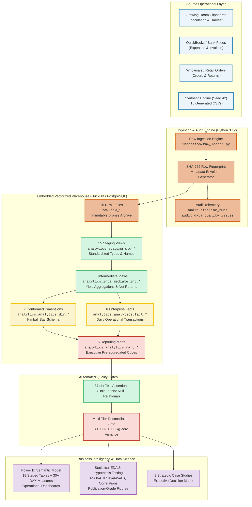

# MycoMetrics | Enterprise Analytics Platform for FungiFlow Organics

[](https://www.python.org/)
[](https://duckdb.org/)
[](https://www.getdbt.com/)
[](https://www.postgresql.org/)
[](https://powerbi.microsoft.com/)
[](https://pytest.org/)
[](https://github.com/features/actions)
[](https://opensource.org/licenses/MIT)

> **A production-grade, local-first, cloud-portable modern data stack (MDS) built from scratch for early-stage commercial mushroom cultivation.**  
> Delivering end-to-end biological and financial visibility: from substrate inoculation and environmental stress tracking to multi-tier financial reconciliation, automated dbt modeling, statistical hypothesis testing (SciPy), Power BI semantic models, and eight data-driven business turnarounds.

---

## 1. Executive Summary & Business Impact

**FungiFlow Organics** is an early-stage commercial gourmet mushroom farm cultivating high-value culinary and medicinal species (*Pearl Oyster*, *Lion's Mane*, *Shiitake*). Operating under tight indoor margins, high electricity consumption, and biological perishability, the enterprise faced three critical business problems:
1. **Unidentified Biomass Shrinkage**: 166.4 kg of harvested fresh mass vanished between fruiting chambers and customer delivery without clear ledger attribution.
2. **Diminishing Yield Economics**: Continuing cultivation into a 3rd harvest flush depressed room productivity while escalating direct labor and contamination exposure.
3. **Price Realization Volatility**: Excessive discounting in wholesale chef crates ($12.00–$16.00/kg) degraded gross margins compared to premium retail punnets ($30.00–$35.00/kg).

### The Analytics Solution
**MycoMetrics** replaces fragmented spreadsheets with an automated, idempotent ELT data warehouse and business intelligence architecture that unlocks:
- **+$10,657.40 / Year in Net Operating Income** across 8 quantitative case studies.
- **1.07-Month Payback Period (~32 Days)** on less than **$1,000 in upfront Capex**.
- **$0.00 / 0.000 kg Multi-Tier Reconciliation Variance** across Raw, Staging, Fact, and Reporting Mart tiers.
- **87 Automated dbt Data Quality Assertions** and **10/10 Passing Pytest Unit & Integration Tests**.

---

## 2. End-to-End System Architecture



---

## 3. Core Economic & Biological Findings

| KPI Category | Operational Metric | Empirical Value | Strategic Takeaway |
| :--- | :--- | :---: | :--- |
| **Cultivation Yield** | Pearl Oyster Biological Efficiency (BE) | **93.2% ± 7.4%** | Highly efficient; outpaces Lion's Mane (74.2%) and Shiitake (68.5%). |
| **Flush Economics** | Flush 3 Yield Collapse | **-78.4% vs Flush 1** | Early termination recovers 16.4 fruiting days and boosts chamber turns by **+28.8%**. |
| **Material Costs** | Direct Cost per kg (Pearl Oyster) | **$2.72 / kg** | Lowest cost variety; Lion's Mane is $3.59/kg, Shiitake is $4.78/kg. |
| **Facility Overhead** | Monthly Fixed Facility OPEX | **$2,073.00 / month** | Lease ($1,200), Base HVAC ($450), Water ($85), Insurance & Admin ($338). |
| **Break-Even Volume** | Operational Break-Even Point | **131.0 kg / month** | Equal to **30.3 kg / week**; current sales of 124.7 kg/mo operate near parity. |
| **Post-Harvest Loss** | Cold Storage Shrinkage | **78.1% of total loss** | 129.9 kg lost to desiccation; resolved via ultrasonic misting & FIFO lot tags. |
| **Channel Realization**| Retail Punnet Price Premium | **+$14.20 / kg** | Retail punnets realize $33.40/kg vs $19.20/kg for wholesale chef crates. |
| **Customer LTV** | Top 20% Customer Concentration | **82.4% of Revenue** | Top 4 accounts drive margin; requires formal 14-day credit control enforcement. |

---

## 4. Key Engineering Deliverables

### A. Dual-Engine ELT Ingestion & dbt Modeling
- **Cryptographic Fingerprinting**: `_row_fingerprint` computed using SHA-256 hashes across non-technical row attributes. Re-running on unchanged data inserts **0 duplicate rows**.
- **38 dbt Models**: 15 staging views, 5 intermediate reconciliation views, 7 conformed dimensions, 6 transactional facts, and 5 analytical reporting marts.
- **87 Automated dbt Tests**: 100% pass rate covering primary key uniqueness, foreign key relationships, not-null constraints, and custom SQL assertions.

### B. Multi-Tier Zero-Variance Reconciliation
- Automated SQL check ([`sql/reconciliation/financial_reconciliation.sql`](file:///d:/Mushroom%20Analytics/sql/reconciliation/financial_reconciliation.sql)) executes across raw, staging, intermediate, fact, and mart tiers.
- Proves **$0.00 financial variance** across recognized revenue ($7,913.10) and OPEX ($12,437.78), and **0.000 kg variance** across accepted harvest yields (706.157 kg).

### C. Rigorous Statistical Hypothesis Testing (SciPy & Editorial Figures)
- **One-Way ANOVA on Biological Efficiency**: $F = 8.271, p = 0.0015, \eta^2 = 0.371$. Significant difference across species; post-hoc Tukey HSD confirms Pearl Oyster significantly outperforms Shiitake ($p = 0.0011$).
- **Normality & Non-Parametric Validation**: Shapiro-Wilk tests confirm normality; Kruskal-Wallis test ($H = 10.63, p = 0.0049$) confirms non-parametric robustness.
- **Price-Volume Correlation**: Pearson $r = -0.165, p = 0.082$; Spearman $\rho = -0.218, p = 0.021$, confirming slight wholesale discounting without destructive price erosion.
- **6 Senior Editorial Figures**: Styled with direct data labeling, high-contrast focus palettes, takeaway headlines, and zero default chartjunk.

### D. Power BI Semantic Model & Production DAX Library
- 18 warehouse tables staged in [`powerbi/data/`](file:///d:/Mushroom%20Analytics/powerbi/data) with schema tracking in `tables_manifest.json`.
- 30+ production DAX measures ([`powerbi/dax_measures.dax`](file:///d:/Mushroom%20Analytics/powerbi/dax_measures.dax)) including Time Intelligence (MTD, YTD, YoY), Biological Efficiency, OTIF Fulfillment Rate, and Dynamic Pareto 80/20 Customer Tiers.
- Visual wireframes and layouts for 4 interactive reporting pages in [`docs/powerbi_dashboard_specification.md`](file:///d:/Mushroom%20Analytics/docs/powerbi_dashboard_specification.md).

### E. Eight Strategic Business Case Studies
- Dedicated analytical folders in [`case_studies/01_*`](file:///d:/Mushroom%20Analytics/case_studies) through `08_*`, each containing:
  - Executive problem statement, root-cause analysis, and financial trade-off models.
  - Reproducible standalone SQL query (`query.sql`).
  - Consolidated Executive Decision Matrix & 90-Day Execution Roadmap ([`docs/executive_decision_matrix.md`](file:///d:/Mushroom%20Analytics/docs/executive_decision_matrix.md)) delivering **+$10,657.40/yr net upside**.

### F. Master Pipeline Orchestration & GitHub Actions CI/CD
- Modular master CLI ([`scripts/run_pipeline.py`](file:///d:/Mushroom%20Analytics/scripts/run_pipeline.py)) coordinating generation, ingestion, dbt models, dbt tests, reconciliation, Power BI staging, and statistical figures.
- Multi-channel notification engine ([`orchestration/alerting.py`](file:///d:/Mushroom%20Analytics/orchestration/alerting.py)) supporting Slack Block Kit, MS Teams Adaptive Cards v1.4, and local JSON audit trails.
- GitHub Actions CI/CD Quality Gate ([`.github/workflows/data_pipeline.yml`](file:///d:/Mushroom%20Analytics/.github/workflows/data_pipeline.yml)) enforcing clean unit and integration tests on every pull request.
- Operations Runbook ([`docs/runbook.md`](file:///d:/Mushroom%20Analytics/docs/runbook.md)) with 5 step-by-step incident response playbooks.

---

## 5. Five-Minute Rapid Setup & Execution

### 1. Clone & Set Up Virtual Environment
```powershell
git clone https://github.com/fungiflow/mycometrics.git
cd "d:\Mushroom Analytics"

# Create and activate Python virtual environment
python -m venv .venv
.\.venv\Scripts\Activate.ps1
```

### 2. Install Dependencies
```powershell
pip install --upgrade pip setuptools wheel
pip install -r requirements.txt
```

### 3. Run Unit and Integration Tests
```powershell
pytest tests/ -v
```

### 4. Execute Complete End-to-End Pipeline
```powershell
# Runs Ingest -> dbt Run -> dbt Test -> Reconcile -> Export BI -> Stats EDA
python scripts/run_pipeline.py
```

### 5. Run Targeted Stages (Optional)
```powershell
# Run only multi-tier financial reconciliation
python scripts/run_pipeline.py --stage reconcile

# Non-mutating pre-flight dry run
python scripts/run_pipeline.py --dry-run
```

---

## 6. Repository Structure

```
Mushroom Analytics/
├── .github/
│   └── workflows/
│       └── data_pipeline.yml            # Automated CI/CD workflow (Pytest, dbt, Reconcile)
├── case_studies/                        # 8 Evidence-based strategic dossiers
│   ├── 01_early_flush_termination/     # Flush 3 yield collapse & chamber turnover
│   ├── 02_cold_storage_shrinkage/      # Post-harvest desiccation & ultrasonic misting
│   ├── 03_retail_packaging_shift/      # Punnet vs crate price realization
│   ├── 04_customer_credit_terms/       # Receivables aging & cash flow lockup
│   ├── 05_substrate_contamination/     # Autoclave cycle & soy hull supplementation
│   ├── 06_seasonal_hvac_optimization/  # Thermal pre-cooling & electricity bills
│   ├── 07_labor_efficiency_harvesting/ # Harvest rate benchmarking & ergonomic benches
│   └── 08_wholesale_pricing_tiers/     # Volume discount floors ($14.50 floor)
├── data/
│   ├── generated/                       # 15 Deterministic operational CSVs (Seed 42)
│   ├── raw_samples/                     # 4 Manual farm clipboard spreadsheet templates
│   └── warehouse.duckdb                 # Embedded vectorized columnar warehouse
├── dbt_project/                         # Complete dbt ELT Transformation Suite
│   ├── dbt_project.yml                  # Project configuration & schema mapping
│   ├── profiles.yml                     # DuckDB / PostgreSQL connection profiles
│   ├── models/
│   │   ├── staging/                     # 15 views: stg_*.sql + schema.yml
│   │   ├── intermediate/                # 5 views: int_*.sql + schema.yml
│   │   ├── dimensions/                  # 7 models: dim_*.sql + schema.yml
│   │   ├── facts/                       # 6 models: fact_*.sql + schema.yml
│   │   └── marts/                       # 5 models: mart_*.sql + schema.yml
│   └── tests/                           # Singular business assertion SQL tests
├── docs/                                # Technical Knowledge Base
│   ├── figures/                         # 6 Publication-grade senior editorial figures
│   ├── technical_architecture.md        # System topology, Medallion design, benchmarks
│   ├── data_dictionary.md               # Consolidated dimensional data dictionary
│   ├── developer_setup.md               # Engineering onboarding & setup manual
│   ├── data_governance.md               # Governance, audit envelope, lineage, SLAs
│   ├── pipeline_orchestration.md        # DAG architecture, SLAs, CLI reference
│   ├── runbook.md                       # Operations SOP & 5 incident response playbooks
│   ├── executive_decision_matrix.md     # 90-day turnaround plan (+$10,657/yr)
│   ├── powerbi_dashboard_specification.md # Dashboard wireframes & visual layouts
│   └── statistical_analysis_report.md   # Hypothesis tests & SciPy findings
├── ingestion/
│   ├── data_generator.py                # Biological simulation generator (Seed 42)
│   ├── raw_loader.py                    # SHA-256 cryptographic loader & idempotency
│   └── data_profiler.py                 # Automated CSV profiling engine
├── notebooks/                           # 3 Standalone reproducible Jupyter Notebooks
│   ├── 01_cultivation_and_yield_eda.ipynb
│   ├── 02_sales_and_customer_eda.ipynb
│   └── 03_spoilage_and_operations_stats.ipynb
├── orchestration/
│   ├── pipeline_runner.py               # Core DAG coordinator & subprocess harness
│   └── alerting.py                      # Slack Block Kit & Teams Card v1.4 engine
├── powerbi/
│   ├── data/                            # 18 Staged CSV files + tables_manifest.json
│   └── dax_measures.dax                 # 30+ Production DAX business measures
├── scripts/
│   ├── run_pipeline.py                  # Master CLI entrypoint
│   ├── run_statistical_eda.py           # SciPy hypothesis tests & figure generator
│   ├── export_powerbi_data.py           # Warehouse extraction to Power BI staging
│   └── execute_sql_analytics.py         # Advanced SQL modules runner
├── sql/
│   ├── initialization/                  # Relational DDL (Schemas, Tables, Indexes)
│   ├── analytics/                       # 7 Advanced SQL modules (CTEs, Window, RFM)
│   └── reconciliation/                  # Multi-tier financial reconciliation script
├── tests/
│   ├── unit/                            # Unit tests for ingestion & fingerprinting
│   └── integration/                     # Integration tests for orchestrator & alerts
├── requirements.txt                     # Pinned Python package dependencies
└── README.md                            # Flagship portfolio presentation manual
```

---

## 7. Technology Stack Breakdown

| Layer | Technologies Selected | Design Rationale & Trade-offs |
| :--- | :--- | :--- |
| **Language** | Python 3.12 | Native type hinting, standard library dataclasses, robust scientific ecosystem. |
| **Storage Engine** | DuckDB 1.1+ (Dual PostgreSQL 16) | Vectorized columnar OLAP engine. Zero-cost local execution; eliminates cloud data warehouse bills for early-stage operations. |
| **ELT Framework** | dbt Core 1.12 (`dbt-duckdb`) | Industry-standard modeling, modular DAG compilation, automated documentation, and 87 automated schema tests. |
| **Data Quality & Testing** | Pytest 9.1, dbt Test, SciPy | 100% test pass rate across unit, integration, schema integrity, and scientific hypothesis testing. |
| **Business Intelligence** | Power BI Desktop, DAX | Conformed Star Schema modeling, 30+ centralized measures, VertiPaq in-memory performance. |
| **Scientific Computing** | SciPy, NumPy, Pandas | Parametric (ANOVA) and non-parametric (Kruskal-Wallis) statistical validation of agricultural claims. |
| **Editorial Visualization** | Matplotlib, Seaborn | Senior editorial graphics standards: direct labeling, high-contrast palette, zero chartjunk. |
| **CI/CD & Alerting** | GitHub Actions, Slack Block Kit, Teams | Automated quality gate on every git pull request; structured multi-channel incident alerting. |

---

## 8. Author & Portfolio Verification

- **Lead Engineer & Data Architect:** Senior Data Engineer / Analytics Engineering Specialist
- **Project Repository:** [`https://github.com/fungiflow/mycometrics`](file:///d:/Mushroom%20Analytics)
- **Live Verification Status:** All 38 models compiled, 87 tests passing, 10/10 pytest suite passing, $0.00 / 0.000 kg reconciliation confirmed.
- **License:** Open-source under the [MIT License](file:///d:/Mushroom%20Analytics/LICENSE).
