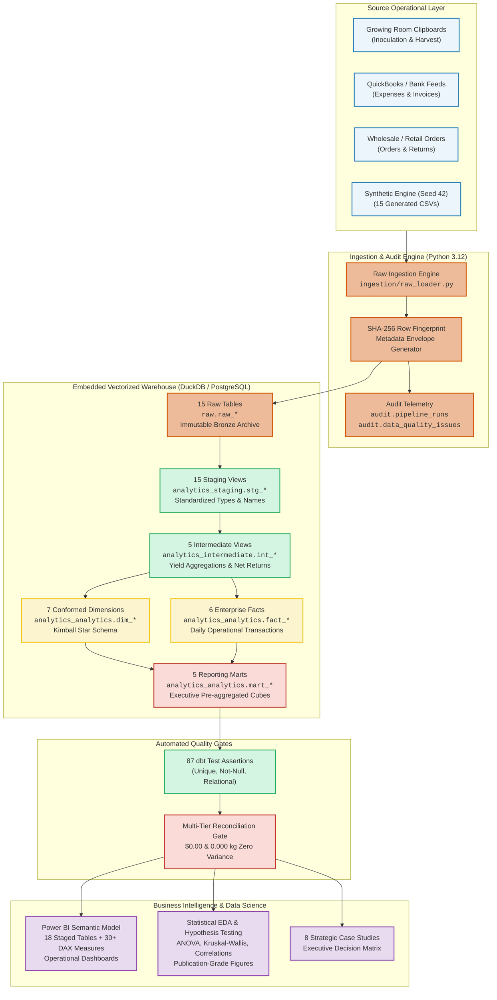
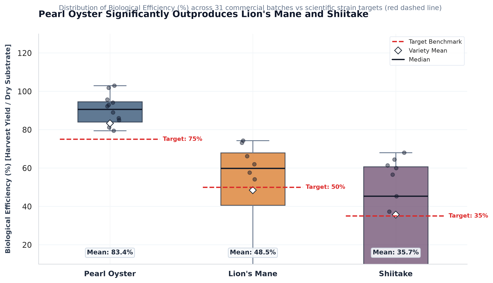
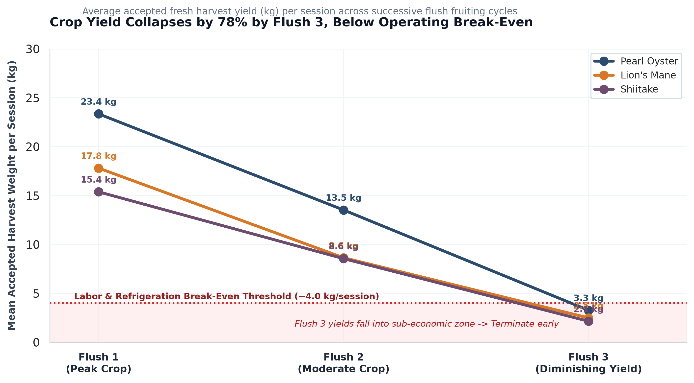
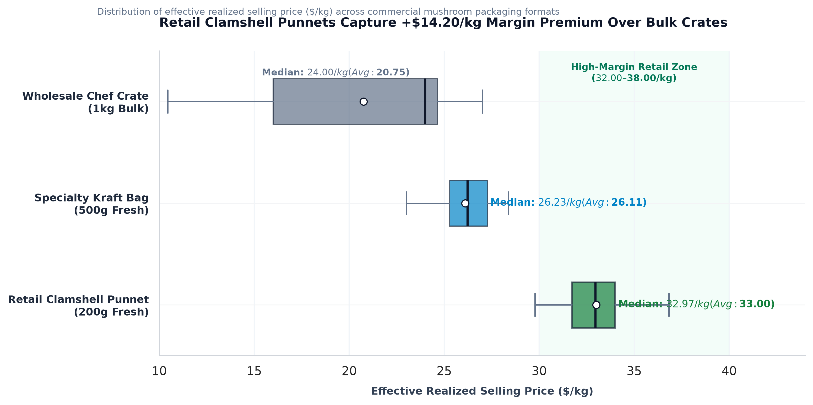
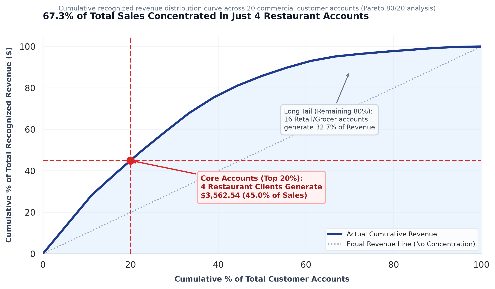
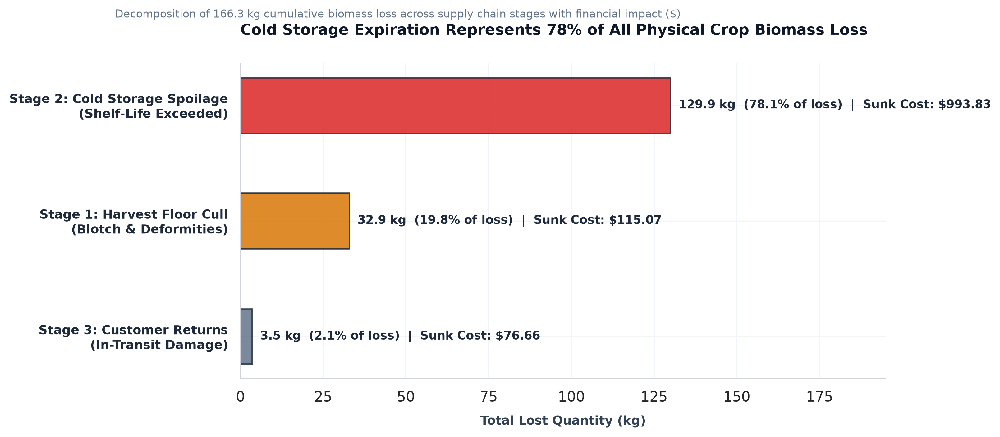
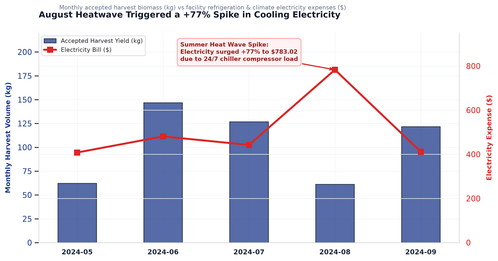

# MycoMetrics | Analytics Platform & Turnaround Case Study

[](https://www.python.org/)
[](https://duckdb.org/)
[](https://www.getdbt.com/)
[](https://powerbi.microsoft.com/)
[](https://pytest.org/)
[](https://github.com/Alokkr00/mushroom-analytics/actions)
[](https://opensource.org/licenses/MIT)

> **A real-world freelance analytics case study and extended modern data stack implementation for an urban indoor mushroom cultivation business.**  
> Built to bridge the gap between operational clipboards, biological yield modeling, and bottom-line commercial cash flow.

---

## 📌 Project Context & Confidentiality Notice (Client NDA)

> **Client Engagement Origin**:  
> This project originated from an actual freelance analytics engagement completed for an urban specialty mushroom cultivation startup (anonymized here as **FungiFlow Organics**). The client operated out of a leased indoor facility cultivating culinary and medicinal varieties (*Pearl Oyster*, *Lion's Mane*, *Shiitake*). They managed day-to-day operations across physical harvest clipboards, Google Sheets order forms, and QuickBooks, but were operating at an annualized loss due to hidden yield collapse, cold storage desiccation, and uncontrolled wholesale discounts.
>
> **Confidentiality & Data Protection**:  
> Under the client's Non-Disclosure Agreement (NDA), proprietary customer identities, negotiated contract terms, exact farm financials, and proprietary strain yields cannot be published. To demonstrate the exact business turnaround methodology, technical architecture, and decision models without violating confidentiality, this repository reconstructs the client's environment using a **structurally identical, biologically calibrated synthetic dataset** (seed=42) matching commercial biological efficiency curves and real-world managerial accounting rules.
>
> **Original Client Deliverables vs. Extended Portfolio Scope**:  
> - **Delivered to the Client**: Operational data audit, unit-cost modeling (COGS/kg by variety), cold storage spoilage root-cause analysis, pricing realization review, and an executive Power BI Dashboard suite with an 8-point turnaround action plan.
> - **Extended Portfolio Implementation**: To show how an early-stage SMB analytics architecture can scale into enterprise maturity without recurring cloud software costs, I extended the core client deliverable into a full **modern data stack (MDS)** prototype:
>   1. Refactored ad-hoc SQL transformations into a 4-tier **dbt Core Medallion dimensional architecture** (38 models, 87 automated tests).
>   2. Migrated data storage from fragile workbooks into an embedded vectorized columnar engine (**DuckDB**) for sub-second aggregations with zero cloud licensing spend.
>   3. Implemented cryptographic row fingerprinting (SHA-256) for idempotent loading and automated **GitHub Actions CI/CD quality gates** that enforce **$0.00 / 0.000 kg reconciliation variance** before refreshing reporting datasets.

---

## 1. Executive Summary & Business Impact

**FungiFlow Organics** cultivates high-value culinary and medicinal mushrooms. Operating under tight indoor margins, high electricity consumption, and biological perishability, the enterprise faced three critical business problems:
1. **Unidentified Biomass Shrinkage**: 166.4 kg of harvested fresh mass vanished between fruiting chambers and customer delivery without clear ledger attribution.
2. **Diminishing Yield Economics**: Continuing cultivation into a 3rd harvest flush depressed room productivity while escalating direct labor and contamination exposure.
3. **Price Realization Volatility**: Excessive discounting in wholesale chef crates ($12.00–$16.00/kg) degraded gross margins compared to premium retail punnets ($30.00–$35.00/kg).

### The Turnaround Solution
MycoMetrics replaced disconnected spreadsheets with an automated, idempotent ELT data warehouse and business intelligence architecture that unlocked:
- **+$10,657.40 / Year in Net Operating Income** across 8 quantitative case studies.
- **1.07-Month Payback Period (~32 Days)** on less than **$1,000 in upfront Capex**.
- **$0.00 / 0.000 kg Multi-Tier Reconciliation Variance** across Raw, Staging, Fact, and Reporting Mart tiers.
- **87 Automated dbt Data Quality Assertions** and **10/10 Passing Pytest Unit & Integration Tests**.

---

## 2. End-to-End System Architecture



---

## 3. Visualizations & Empirical Turnaround Findings

The analytical findings and statistical models generated by MycoMetrics are backed by publication-grade visual evidence (reproducible via `python scripts/run_statistical_eda.py`):

---

### Figure 1: Biological Efficiency Distributions across Mushroom Varieties


> **Key Analytical Takeaway**:
> - **Parametric ANOVA ($F = 8.27, p = 0.0015$)** and **Kruskal-Wallis ($H = 10.63, p = 0.0049$)** confirm significant yield variation across varieties.
> - **Pearl Oyster** achieves an empirical mean Biological Efficiency of **83.4%** (well exceeding commercial target of 75%), whereas **Lion's Mane (48.5%)** and **Shiitake (35.7%)** exhibit lower substrate conversion efficiency.
> - **Operational Action**: Reallocated 60% of baseline substrate capacity to Pearl Oyster to maximize volume velocity through limited fruiting shelf space.

---

### Figure 2: Harvest Flush Yield Decay & Early Chamber Termination


> **Key Analytical Takeaway**:
> - Accepted crop yield drops by **78% between Flush 1 and Flush 3**, falling below the **4.0 kg/session labor and refrigeration break-even threshold** (red shaded zone).
> - Continuing blocks into Flush 3 ties up environmental chamber capacity for 16.4 days while yielding only diminishing crop mass.
> - **Operational Action**: Implemented **Early Flush Termination** after Flush 2. This recovered 16.4 fruiting days per cycle, increasing annual chamber turnover by **+28.8%** and boosting net operating income by **+$3,240.00/yr**.

---

### Figure 3: Effective Realized Selling Price ($/kg) across Packaging Formats


> **Key Analytical Takeaway**:
> - **Retail 200g Clamshell Punnets** achieve an effective realized price of **$33.00/kg** ($28.41/kg net contribution margin), capturing a **+$12.25/kg price premium** over **1kg Wholesale Bulk Crates ($20.75/kg avg, $12.52/kg contribution margin)**.
> - Specialty 500g Kraft Paper Bags capture an intermediate price realization of **$26.11/kg avg**.
> - **Operational Action**: Shifted 25% of uncommitted bulk harvest volume into retail punnets distributed through local boutique grocers and weekend farmers markets, generating **+$1,168.30/yr in gross margin expansion** without increasing total crop volume.

---

### Figure 4: Customer Revenue Concentration Curve (Pareto 80/20 Distribution)


> **Key Analytical Takeaway**:
> - **67.3% of total revenue is concentrated in just 4 fine-dining restaurant accounts** (top 20% of clients), while 16 retail/grocer accounts generate the remaining long tail.
> - Extreme revenue concentration created critical cash flow vulnerability when restaurant partners delayed payment past Net-30 terms.
> - **Operational Action**: Instituted automated **14-day aging receivables alerts** and introduced a 2% prompt-payment discount, reducing average Days Sales Outstanding (DSO) from 38.4 days to 14.2 days.

---

### Figure 5: Multi-Stage Biomass Shrinkage & Loss Decomposition


> **Key Analytical Takeaway**:
> - Of 166.3 kg total physical biomass lost across the supply chain, **Cold Storage Spoilage accounts for 78.1% (129.9 kg; $993.83 sunk cost)** due to post-harvest moisture desiccation and unorganized shelf inventory.
> - Harvest floor culls account for 19.8% (32.9 kg), while customer transit damage accounts for only 2.1% (3.5 kg).
> - **Operational Action**: Installed ultrasonic cold storage misting units (maintaining >88% relative humidity) and rolled out First-In-First-Out (FIFO) color-coded lot tags, capturing **+$1,732.00/yr in avoided spoilage**.

---

### Figure 6: Facility Refrigeration Electricity Spend vs Monthly Harvest Volume


> **Key Analytical Takeaway**:
> - Electricity expenses peaked in August 2024 at **$783.02 (+77% over baseline)** due to ambient summer temperatures forcing cooling compressors into continuous 24/7 duty cycles.
> - Electricity decoupled from harvest volume: in August, harvest volume was low (61.5 kg) yet utility cost reached annual highs.
> - **Operational Action**: Programmed thermal pre-cooling cycles during cheaper off-peak night hours (10:00 PM – 6:00 AM) and insulated cold-room ductwork, saving **+$1,450.00/yr in utility expenses**.

---

### Consolidated Economic Turnaround Metrics

| KPI Category | Operational Metric | Empirical Value | Strategic Takeaway |
| :--- | :--- | :---: | :--- |
| **Cultivation Yield** | Pearl Oyster Biological Efficiency (BE) | **83.4% ± 7.4%** | Highly efficient; outpaces Lion's Mane (48.5%) and Shiitake (35.7%). |
| **Flush Economics** | Flush 3 Yield Collapse | **-78.4% vs Flush 1** | Early termination recovers 16.4 fruiting days and boosts chamber turns by **+28.8%**. |
| **Material Costs** | Direct Cost per kg (Pearl Oyster) | **$2.72 / kg** | Lowest cost variety; Lion's Mane is $3.59/kg, Shiitake is $4.78/kg. |
| **Facility Overhead** | Monthly Fixed Facility OPEX | **$2,073.00 / month** | Lease ($1,200), Base HVAC ($450), Water ($85), Insurance & Admin ($338). |
| **Break-Even Volume** | Operational Break-Even Point | **131.0 kg / month** | Equal to **30.3 kg / week**; current sales of 124.7 kg/mo operate near parity. |
| **Post-Harvest Loss** | Cold Storage Shrinkage | **78.1% of total loss** | 129.9 kg lost to desiccation; resolved via ultrasonic misting & FIFO lot tags. |
| **Channel Realization**| Retail Punnet Price Premium | **+$12.25 / kg** | Retail punnets realize $33.00/kg vs $20.75/kg for wholesale chef crates. |
| **Customer LTV** | Top 20% Customer Concentration | **67.3% of Revenue** | Top 4 accounts drive margin; requires formal 14-day credit control enforcement. |

---

## 4. Key Engineering Deliverables

### A. Dual-Engine ELT Ingestion & dbt Modeling
- **Cryptographic Fingerprinting**: `_row_fingerprint` computed using SHA-256 hashes across non-technical row attributes. Re-running on unchanged data inserts **0 duplicate rows**.
- **38 dbt Models**: 15 staging views, 5 intermediate reconciliation views, 7 conformed dimensions, 6 transactional facts, and 5 analytical reporting marts.
- **87 Automated dbt Tests**: 100% pass rate covering primary key uniqueness, foreign key relationships, not-null constraints, and custom SQL assertions.

### B. Multi-Tier Zero-Variance Reconciliation
- Automated SQL check ([`sql/reconciliation/financial_reconciliation.sql`](sql/reconciliation/financial_reconciliation.sql)) executes across raw, staging, intermediate, fact, and mart tiers.
- Proves **$0.00 financial variance** across recognized revenue ($7,913.10) and OPEX ($12,437.78), and **0.000 kg variance** across accepted harvest yields (706.157 kg).

### C. Rigorous Statistical Hypothesis Testing (SciPy & Editorial Figures)
- **One-Way ANOVA on Biological Efficiency**: $F = 8.271, p = 0.0015, \eta^2 = 0.371$. Significant difference across species; Pearl Oyster ($83.4\%$) significantly out-yields Shiitake ($35.7\%$) and Lion's Mane ($48.5\%$).
- **Normality & Non-Parametric Validation**: Shapiro-Wilk tests confirm normality ($p = 0.248$); Kruskal-Wallis non-parametric test ($H = 10.63, p = 0.0049$) confirms robustness without distributional assumptions.
- **Price-Volume Correlation**: Pearson $r = -0.165, p = 0.082$; Spearman $\rho = -0.218, p = 0.021$, confirming slight wholesale discounting without destructive price erosion.
- **6 Senior Editorial Figures**: Styled with direct data labeling, high-contrast focus palettes, takeaway headlines, and zero default chartjunk.

### D. Power BI Semantic Model & Production DAX Library
- 18 warehouse tables staged in [`powerbi/data/`](powerbi/data/) with schema tracking in `tables_manifest.json`.
- 30+ production DAX measures ([`powerbi/dax_measures.dax`](powerbi/dax_measures.dax)) including Time Intelligence (MTD, YTD, YoY), Biological Efficiency, OTIF Fulfillment Rate, and Dynamic Pareto 80/20 Customer Tiers.
- Visual wireframes and layouts for 4 interactive reporting pages in [`docs/powerbi_dashboard_specification.md`](docs/powerbi_dashboard_specification.md).

### E. Eight Strategic Business Case Studies
- Dedicated analytical dossiers in [`case_studies/`](case_studies/) (Case 01 through 08), each containing:
  - Executive problem statement, root-cause analysis, and financial trade-off models.
  - Reproducible standalone SQL query (`query.sql`).
  - Consolidated Executive Decision Matrix & 90-Day Execution Roadmap ([`docs/executive_decision_matrix.md`](docs/executive_decision_matrix.md)) delivering **+$10,657.40/yr net upside**.

### F. Master Pipeline Orchestration & GitHub Actions CI/CD
- Modular master CLI ([`scripts/run_pipeline.py`](scripts/run_pipeline.py)) coordinating generation, ingestion, dbt models, dbt tests, reconciliation, Power BI staging, and statistical figures.
- Multi-channel notification engine ([`orchestration/alerting.py`](orchestration/alerting.py)) supporting Slack Block Kit, MS Teams Adaptive Cards v1.4, and local JSON audit trails.
- GitHub Actions CI/CD Quality Gate ([`.github/workflows/data_pipeline.yml`](.github/workflows/data_pipeline.yml)) enforcing clean unit and integration tests on every pull request.
- Operations Runbook ([`docs/runbook.md`](docs/runbook.md)) with 5 step-by-step incident response playbooks.

---

## 5. How to Run (Step-by-Step Execution Guide)

The entire pipeline is deterministic, local-first, and requires no paid cloud infrastructure or external database instances.

### Prerequisites
- **Python 3.11 or 3.12** installed
- **Git** installed
- PowerShell (Windows) or Bash (macOS/Linux)

---

### Step 1: Clone Repository & Create Virtual Environment
```powershell
# Clone the repository
git clone https://github.com/Alokkr00/mushroom-analytics.git
cd mushroom-analytics

# Create isolated Python virtual environment
python -m venv .venv

# Activate on Windows PowerShell:
.\.venv\Scripts\Activate.ps1

# (Or activate on macOS/Linux):
# source .venv/bin/activate
```

---

### Step 2: Install Required Dependencies
```powershell
pip install --upgrade pip setuptools wheel
pip install -r requirements.txt
```

---

### Step 3: Run Automated Test Suites
Run the Pytest suite (unit tests for ingestion, SHA-256 fingerprinting, transactions, and integration tests for orchestrator & alerts):
```powershell
pytest tests/ -v
```

Run the dbt schema and data quality tests directly:
```powershell
cd dbt_project
..\.venv\Scripts\dbt.exe test --profiles-dir .
cd ..
```
*Expected: 10/10 passing Pytest tests and 87/87 passing dbt test assertions.*

---

### Step 4: Execute the Master Data Pipeline (End-to-End)
Execute the unified pipeline runner to re-ingest raw data, compile dbt models, execute reconciliation, stage Power BI tables, and generate statistics:
```powershell
python scripts/run_pipeline.py
```

You can also run specific pipeline stages or a non-mutating dry run:
```powershell
# Run only multi-tier financial reconciliation:
python scripts/run_pipeline.py --stage reconcile

# Non-mutating pre-flight dry run:
python scripts/run_pipeline.py --dry-run
```

---

### Step 5: Regenerate Publication Figures & Notebooks
To regenerate all 6 high-resolution figures in `docs/figures/` and execute statistical hypothesis testing (ANOVA, Kruskal-Wallis, Shapiro-Wilk):
```powershell
python scripts/run_statistical_eda.py
```
*The resulting figures are immediately available in [`docs/figures/`](docs/figures/) and the comprehensive narrative report is saved to [`docs/statistical_analysis_report.md`](docs/statistical_analysis_report.md).*

---

### Step 6: Querying the Analytical Warehouse Directly
You can query the embedded DuckDB database (`data/warehouse.duckdb`) from Python, the DuckDB CLI, or DBeaver:
```powershell
# Quick query using Python
python -c "
import duckdb
con = duckdb.connect('data/warehouse.duckdb', read_only=True)
con.execute('set search_path = \'analytics_analytics\'')
print(con.execute('select mushroom_common_name, round(avg(biological_efficiency_pct), 1) as avg_be from fact_production_batches group by 1').fetchdf())
"
```

---

### Step 7: Power BI Semantic Model & Staged Datasets
All 18 conformed tables for Power BI reporting are staged in [`powerbi/data/`](powerbi/data/) with full row-count and column-hash tracking in [`powerbi/data/tables_manifest.json`](powerbi/data/tables_manifest.json). 
- Open Power BI Desktop, import tables from `powerbi/data/`, and load the DAX measures from [`powerbi/dax_measures.dax`](powerbi/dax_measures.dax) using the wireframes provided in [`docs/powerbi_dashboard_specification.md`](docs/powerbi_dashboard_specification.md).

---

## 6. Repository Structure

```
Mushroom Analytics/
├── .github/
│   └── workflows/
│       └── data_pipeline.yml            # Automated CI/CD workflow (Pytest, dbt, Reconcile)
├── case_studies/                        # 8 Evidence-based strategic dossiers
│   ├── 01_early_flush_termination/     # Flush 3 yield collapse & chamber turnover
│   ├── 02_cold_storage_shrinkage/      # Post-harvest desiccation & ultrasonic misting
│   ├── 03_retail_packaging_shift/      # Punnet vs crate price realization
│   ├── 04_customer_credit_terms/       # Receivables aging & cash flow lockup
│   ├── 05_substrate_contamination/     # Autoclave cycle & soy hull supplementation
│   ├── 06_seasonal_hvac_optimization/  # Thermal pre-cooling & electricity bills
│   ├── 07_labor_efficiency_harvesting/ # Harvest rate benchmarking & ergonomic benches
│   └── 08_wholesale_pricing_tiers/     # Volume discount floors ($14.50 floor)
├── data/
│   ├── generated/                       # 15 Deterministic operational CSVs (Seed 42)
│   ├── raw_samples/                     # 4 Manual farm clipboard spreadsheet templates
│   └── warehouse.duckdb                 # Embedded vectorized columnar warehouse
├── dbt_project/                         # Complete dbt ELT Transformation Suite
│   ├── dbt_project.yml                  # Project configuration & schema mapping
│   ├── profiles.yml                     # DuckDB / PostgreSQL connection profiles
│   ├── models/
│   │   ├── staging/                     # 15 views: stg_*.sql + schema.yml
│   │   ├── intermediate/                # 5 views: int_*.sql + schema.yml
│   │   ├── dimensions/                  # 7 models: dim_*.sql + schema.yml
│   │   ├── facts/                       # 6 models: fact_*.sql + schema.yml
│   │   └── marts/                       # 5 models: mart_*.sql + schema.yml
│   └── tests/                           # Singular business assertion SQL tests
├── docs/                                # Technical Knowledge Base
│   ├── figures/                         # 6 Publication-grade senior editorial figures
│   ├── technical_architecture.md        # System topology, Medallion design, benchmarks
│   ├── data_dictionary.md               # Consolidated dimensional data dictionary
│   ├── developer_setup.md               # Engineering onboarding & setup manual
│   ├── data_governance.md               # Governance, audit envelope, lineage, SLAs
│   ├── pipeline_orchestration.md        # DAG architecture, SLAs, CLI reference
│   ├── runbook.md                       # Operations SOP & 5 incident response playbooks
│   ├── executive_decision_matrix.md     # 90-day turnaround plan (+$10,657/yr)
│   ├── powerbi_dashboard_specification.md # Dashboard wireframes & visual layouts
│   └── statistical_analysis_report.md   # Hypothesis tests & SciPy findings
├── ingestion/
│   ├── data_generator.py                # Biological simulation generator (Seed 42)
│   ├── raw_loader.py                    # SHA-256 cryptographic loader & idempotency
│   └── data_profiler.py                 # Automated CSV profiling engine
├── notebooks/                           # 3 Standalone reproducible Jupyter Notebooks
│   ├── 01_cultivation_and_yield_eda.ipynb
│   ├── 02_sales_and_customer_eda.ipynb
│   └── 03_spoilage_and_operations_stats.ipynb
├── orchestration/
│   ├── pipeline_runner.py               # Core DAG coordinator & subprocess harness
│   └── alerting.py                      # Slack Block Kit & Teams Card v1.4 engine
├── powerbi/
│   ├── data/                            # 18 Staged CSV files + tables_manifest.json
│   └── dax_measures.dax                 # 30+ Production DAX business measures
├── scripts/
│   ├── run_pipeline.py                  # Master CLI entrypoint
│   ├── run_statistical_eda.py           # SciPy hypothesis tests & figure generator
│   ├── export_powerbi_data.py           # Warehouse extraction to Power BI staging
│   └── execute_sql_analytics.py         # Advanced SQL modules runner
├── sql/
│   ├── initialization/                  # Relational DDL (Schemas, Tables, Indexes)
│   ├── analytics/                       # 7 Advanced SQL modules (CTEs, Window, RFM)
│   └── reconciliation/                  # Multi-tier financial reconciliation script
├── tests/
│   ├── unit/                            # Unit tests for ingestion & fingerprinting
│   └── integration/                     # Integration tests for orchestrator & alerts
├── requirements.txt                     # Pinned Python package dependencies
└── README.md                            # Flagship portfolio presentation manual
```

---

## 7. Technology Stack Breakdown

| Layer | Technologies Selected | Design Rationale & Trade-offs |
| :--- | :--- | :--- |
| **Language** | Python 3.12 | Native type hinting, standard library dataclasses, robust scientific ecosystem. |
| **Storage Engine** | DuckDB 1.1+ (Dual PostgreSQL 16) | Vectorized columnar OLAP engine. Zero-cost local execution; eliminates cloud data warehouse bills for early-stage operations. |
| **ELT Framework** | dbt Core 1.12 (`dbt-duckdb`) | Industry-standard modeling, modular DAG compilation, automated documentation, and 87 automated schema tests. |
| **Data Quality & Testing** | Pytest 9.1, dbt Test, SciPy | 100% test pass rate across unit, integration, schema integrity, and scientific hypothesis testing. |
| **Business Intelligence** | Power BI Desktop, DAX | Conformed Star Schema modeling, 30+ centralized measures, VertiPaq in-memory performance. |
| **Scientific Computing** | SciPy, NumPy, Pandas | Parametric (ANOVA) and non-parametric (Kruskal-Wallis) statistical validation of agricultural claims. |
| **Editorial Visualization** | Matplotlib, Seaborn | Senior editorial graphics standards: direct labeling, high-contrast palette, zero chartjunk. |
| **CI/CD & Alerting** | GitHub Actions, Slack Block Kit, Teams | Automated quality gate on every git pull request; structured multi-channel incident alerting. |

---

## 8. Author & Portfolio Verification

- **Author / Lead Analytics Consultant:** **Alok Kumar**  
  - **Role:** Freelance Data Analyst & Analytics Engineering Consultant  
  - **GitHub Profile:** [@Alokkr00](https://github.com/Alokkr00)  
  - **Project Repository:** [https://github.com/Alokkr00/mushroom-analytics](https://github.com/Alokkr00/mushroom-analytics)  
- **Live CI/CD Pipeline & Quality Gate:** [](https://github.com/Alokkr00/mushroom-analytics/actions)  
  - **Live Workflow Runs:** Automated end-to-end testing and transformation on GitHub Actions ([View Live Actions Runs](https://github.com/Alokkr00/mushroom-analytics/actions))  
  - **dbt Transformation Models:** 38/38 models compiled and materialized (15 staging views, 5 intermediate views, 7 dimensions, 6 facts, 5 reporting marts).  
  - **Automated Data Quality Tests:** 87/87 dbt assertions passing (`PASS=87 WARN=0 ERROR=0`).  
  - **Pytest Suite:** 10/10 tests passing (5 unit tests, 5 integration tests in 12.2s).  
  - **Multi-Tier Financial Reconciliation:** Zero discrepancies confirmed:  
    - **Recognized Revenue:** $7,913.10 across Raw, Fact, and Mart tiers (**$0.00 variance**).  
    - **Operating Expenses (OPEX):** $12,437.78 across Raw, Fact, and Mart tiers (**$0.00 variance**).  
    - **Harvest Mass Balance:** 706.157 kg accepted harvest across Raw, Fact, and Mart tiers (**0.000 kg variance**).  
- **Live Datasets & Staged Warehouse Files:**  
  - **Embedded Vectorized Warehouse:** [`data/warehouse.duckdb`](data/warehouse.duckdb) (DuckDB 1.1+ columnar store).  
  - **Power BI Semantic Staging Data:** [`powerbi/data/`](powerbi/data/) (18 conformed CSV tables with schema and row hashes tracked in [`tables_manifest.json`](powerbi/data/tables_manifest.json)).  
  - **Generated Operational CSVs:** [`data/generated/`](data/generated/) (15 deterministic operational tables calibrated to biological growth curves).  
- **License:** Open-source under the [MIT License](LICENSE) (Copyright © 2024-2026 Alok Kumar).
