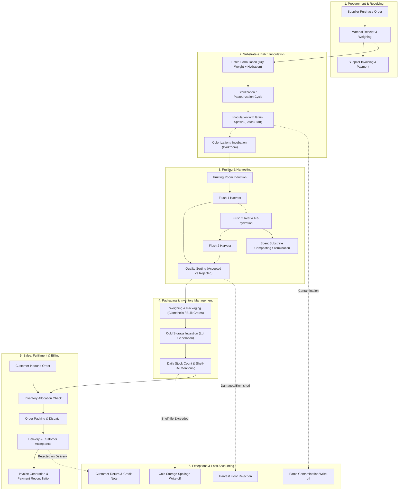

# Business Process Mapping & Exception Handling: MycoMetrics

## 1. Operational Flowchart & Process Stages

---

## 2. Detailed Process Stage Matrix

| Process Step | Action Performed | Recording Actor | Required Fields Captured | Source System / Record | Key Exception Risk | Data Validation Rule | Primary KPI Impacted |
| :--- | :--- | :--- | :--- | :--- | :--- | :--- | :--- |
| **1. Procurement** | Order grain spawn, substrate materials, packaging | Founder / Grower | `purchase_id`, `supplier_id`, `purchase_date`, `material_name`, `qty_ordered`, `qty_received`, `unit_price`, `total_cost` | Purchase Invoice / Paper Receipt | Missing delivery, price hike, contaminated spawn | `qty_received >= 0`, `unit_price > 0`, `total_cost = qty * unit_price` | Material Cost per Kg, Lead Time |
| **2. Batch Creation** | Formulate substrate, sterilize, inoculate spawn | Grower / Cultivation Assistant | `batch_id`, `mushroom_variety`, `substrate_type`, `dry_substrate_kg`, `water_liters`, `spawn_kg`, `batch_start_date`, `room_id` | Growing Log Clipboard / Sheet | Mold contamination (*Trichoderma*), dry bags | `dry_substrate_kg > 0`, `spawn_kg > 0`, `batch_start_date <= TODAY` | Substrate-to-Spawn Ratio, Batch Failure Rate |
| **3. Colonization & Induction** | Incubate bags, move to fruiting room upon 100% run | Grower | `batch_id`, `transfer_date`, `room_id`, `room_target_temp`, `room_target_humidity` | Whiteboard / Room Log | Stall colonization, room temp spike | `transfer_date >= batch_start_date` | Incubation Duration (Days) |
| **4. Harvest & Sorting** | Pick mushrooms, grade into Accepted (Grade A/B) vs Rejected | Grower / Assistant | `harvest_id`, `batch_id`, `harvest_date`, `flush_number`, `gross_weight_kg`, `accepted_weight_kg`, `rejected_weight_kg`, `rejection_reason` | Harvest Log Book | Bruising, spore drop, bacterial blotch | `gross_weight_kg = accepted_weight_kg + rejected_weight_kg` | Total Harvested Kg, Biological Efficiency, Rejection Rate (%) |
| **5. Packaging & Cold Storage** | Pack into clamshells or bulk crates, move to fridge | Assistant | `movement_id`, `product_id`, `lot_id`, `batch_id`, `movement_date`, `movement_type`, `quantity_kg`, `expiry_date` | Inventory Sheet | Pack count mismatch, unlabelled lots | `quantity_kg > 0`, `expiry_date = harvest_date + shelf_life_days` | Available Inventory, Expiry Risk Quantity |
| **6. Order Receiving & Allocation** | Customer orders via phone/email/market | Founder | `order_id`, `customer_id`, `order_date`, `requested_date`, `channel`, `order_status` | Google Sheet Order Form | Stockout, order double-booking | `requested_date >= order_date`, valid `customer_id` | Gross Orders, Stockout Frequency |
| **7. Fulfillment & Delivery** | Weigh crates/packs, deliver to restaurant/store | Founder / Driver | `order_line_id`, `order_id`, `product_id`, `qty_ordered_kg`, `qty_fulfilled_kg`, `unit_price`, `discount_amt` | Delivery Manifest / Sheet | Short fulfillment, delivery transit delay | `qty_fulfilled_kg <= qty_ordered_kg`, `qty_fulfilled_kg >= 0` | Fulfillment Rate (%), Net Sales ($) |
| **8. Invoicing & Collection** | Issue invoice, collect cash or bank transfer | Founder | `order_id`, `invoice_amount`, `payment_status`, `payment_date`, `payment_method` | Bank Statement / Ledger | Delayed payment, bad debt | `invoice_amount = sum(line_net_sales)` | Cash Collected, Days Sales Outstanding |
| **9. Waste & Spoilage Write-off** | Discard unsold slimy/expired mushrooms | Grower | `waste_id`, `lot_id`, `product_id`, `waste_date`, `waste_kg`, `reason_code`, `estimated_cost` | Waste Log Sheet | Failure to log discarded stock | `waste_kg <= remaining_lot_balance` | Spoilage Rate (%), Waste Cost ($) |

---

## 3. Exception Handling & Data Integrity Protocols

1. **Contaminated Batches Prior to Fruiting**:
   - *Protocol*: Entire batch is discarded immediately to prevent room-wide spore contamination.
   - *Data Impact*: Batch status becomes `'CONTAMINATED'`. `harvest_id` will be null or zero. Incurred costs (substrate + spawn + labor) are logged as direct losses.
2. **Harvest Floor Rejections**:
   - *Protocol*: Mushrooms with bacterial blotch, severe dehydration, or insect damage are weighed and composted.
   - *Data Impact*: Recorded in `rejected_weight_kg` with explicit `rejection_reason`. Total harvested weight equals accepted + rejected.
3. **Cold Storage Spoilage**:
   - *Protocol*: Daily morning walk-in audit checks lot expiry dates. Any lot older than 5 days is evaluated; if degraded, an inventory negative movement `WASTE_SPOILAGE` is generated.
   - *Data Impact*: Inventory balance drops; cost is calculated using the batch's attributable unit cost.
4. **Order Short-Fulfillment**:
   - *Protocol*: When fresh harvest yield is insufficient to satisfy wholesale restaurant orders, the available stock is rationed proportionally or high-priority regular accounts are prioritized.
   - *Data Impact*: `qty_ordered_kg` > `qty_fulfilled_kg`. Revenue is calculated ONLY on `qty_fulfilled_kg`. Unfulfilled demand is captured for forecasting and loss-of-sales analytics.
5. **Customer Delivery Rejection / Returns**:
   - *Protocol*: If mushrooms arrive damaged or degraded, customer receives an immediate credit memo.
   - *Data Impact*: Generates a return record referencing `original_order_line_id`, deducting from net revenue. Returned perishable goods are marked as `DISCARDED` (never returned to active stock).
