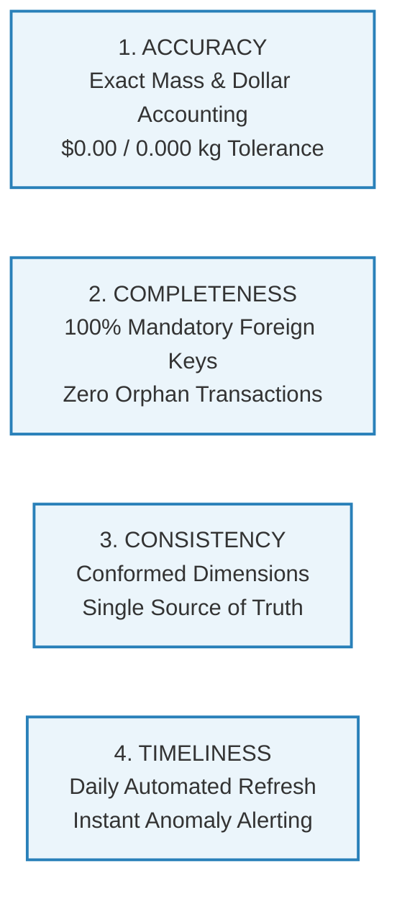
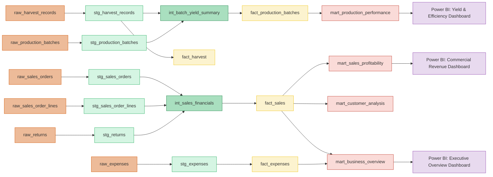

# MycoMetrics Data Governance, Lineage & Quality Policy

**Document Version:** 1.0.0  
**Target Audience:** Analytics Engineers, Farm Operations Managers, Financial Auditors  
**Classification:** Enterprise Data Governance Standard  

---

## 1. Governance Principles & Data Quality Framework

Data integrity in early-stage agricultural operations directly impacts biological yields, commercial cash flow, and regulatory traceability. The **MycoMetrics Data Governance Framework** rests on four core pillars:



1. **Accuracy**: Every dollar recognized and every gram harvested must reconcile end-to-end between farm weigh-scales, invoices, and executive reporting marts.
2. **Completeness**: No transaction reaches reporting marts without mandatory foreign key linkages to conformed dimensions (`dim_date`, `dim_mushroom`, `dim_product`, `dim_customer`).
3. **Consistency**: KPIs such as Biological Efficiency (BE %), Effective ASP ($/kg), and Gross Margin (%) are defined once in centralized dbt models and DAX libraries to prevent divergent business logic.
4. **Timeliness**: Ingestion and transformation run on a scheduled automated cadence with automated alerts dispatched within 5 seconds of failure.

---

## 2. Cryptographic Audit Envelope Standard

To ensure forensic traceability and complete idempotency, every physical record in the `raw` schema must be enriched with an immutable technical metadata envelope:

$$\text{Envelope} = \{\text{\_source\_file}, \text{\_ingested\_at}, \text{\_ingestion\_run\_id}, \text{\_row\_fingerprint}\}$$

### Technical Field Specifications
- **`_source_file` (`VARCHAR(100)`)**: The exact filename from which the record was extracted (e.g. `harvest_records.csv`).
- **`_ingested_at` (`TIMESTAMPTZ`)**: The UTC timestamp at which the row was written into the physical warehouse table.
- **`_ingestion_run_id` (`VARCHAR(50)`)**: Unique execution batch ID in `RUN-YYYYMMDDHHMMSS-<hex>` format.
- **`_row_fingerprint` (`CHAR(64)`)**: A deterministic SHA-256 hash calculated across all natural non-technical attributes of the record:

$$\text{\_row\_fingerprint} = \text{SHA-256}(v_1 \mid v_2 \mid \dots \mid v_k)$$

### Idempotency Guarantee:
If the ingestion pipeline is executed repeatedly against unchanged source CSVs, existing fingerprints match 100%, and the loader inserts **exactly zero duplicate rows**, eliminating accidental double-counting of yield or sales.

---

## 3. Automated Anomaly Logging & Quarantine Protocol

Rather than silently dropping corrupt data or crashing ungracefully, the ingestion engine isolates anomalies into the [`audit.data_quality_issues`](file:///d:/Mushroom%20Analytics/sql/initialization/03_create_audit_tables.sql) table:

```
[Incoming Operational Row]
          │
          ├──► Passes Validation ────────► Insert into `raw.raw_*` Table
          │
          └──► Fails Rule ────────────────► Log into `audit.data_quality_issues`
                                          ├── Severity: WARNING (Log & Ingest)
                                          ├── Severity: ERROR (Exclude from Marts)
                                          └── Severity: CRITICAL (Halt Pipeline)
```

### Anomaly Classification Taxonomy

| Severity | Check Type | Trigger Condition | System Action | Notification |
| :--- | :--- | :--- | :--- | :--- |
| **WARNING** | `DUPLICATE_PRIMARY_KEY` | Primary key appears multiple times in source file with identical values. | Deduplicate deterministically, record anomaly, continue ingestion. | Logged to audit table. |
| **ERROR** | `NEGATIVE_WEIGHT_VALUE` | Harvest weight or ordered quantity $\le 0.00$. | Exclude from staging views via where filters; retain in raw for audit. | Included in daily run summary. |
| **CRITICAL** | `SCHEMA_DRIFT` | Expected mandatory column missing from incoming spreadsheet. | Halt pipeline immediately (`--fail-fast`). | Dispatches Critical Alert to Slack/Teams. |
| **CRITICAL** | `RECONCILIATION_BREACH`| Multi-tier variance exceeds $\$0.00$ or $0.000\text{ kg}$. | Abort pipeline before refreshing Power BI datasets. | Dispatches Critical Alert to Slack/Teams. |

---

## 4. End-to-End Data Lineage Architecture

The lineage below details how raw operational records flow through transformations into consumed business intelligence:



---

## 5. Retention, Archiving & Disaster Recovery SLAs

| Data Asset | Tier | Retention Period | Archival Storage | Backup Cadence |
| :--- | :--- | :--- | :--- | :--- |
| **Operational CSVs** | Source | Permanent (7 Years) | Encrypted Cold Object Storage (S3 / GCS Glacier) | Daily incremental |
| **Raw Warehouse Schema** | Bronze | Permanent (7 Years) | Append-Only DuckDB / PostgreSQL Tables | Daily snapshot |
| **Staging & Intermediate Views** | Silver | Ephemeral | Code-defined in dbt (Version Controlled in Git) | On every git commit |
| **Facts & Conformed Dimensions**| Gold | Operational Lifetime | Materialized DuckDB / PostgreSQL Tables | Daily snapshot |
| **Power BI Staging CSVs** | Gold+ | Rolling 12 Months | Local workspace `powerbi/data/` | Re-staged on every ETL run |
| **Pipeline & Audit Logs** | Audit | 90 Days Hot, 1 Year Cold | `audit.pipeline_runs` & `logs/pipeline_runs/` | Daily incremental |

### Disaster Recovery Service Level Agreements (SLAs):
- **Recovery Point Objective (RPO):** **0 seconds** (Exact Zero Data Loss). All transformations are 100% deterministic and reproducible from raw CSV archives via `python scripts/run_pipeline.py --full-refresh`.
- **Recovery Time Objective (RTO):** **< 3 minutes**. Complete rebuild from raw CSVs to fully materialized marts, passed dbt tests, and staged Power BI files executes in ~76 seconds on standard developer hardware.
