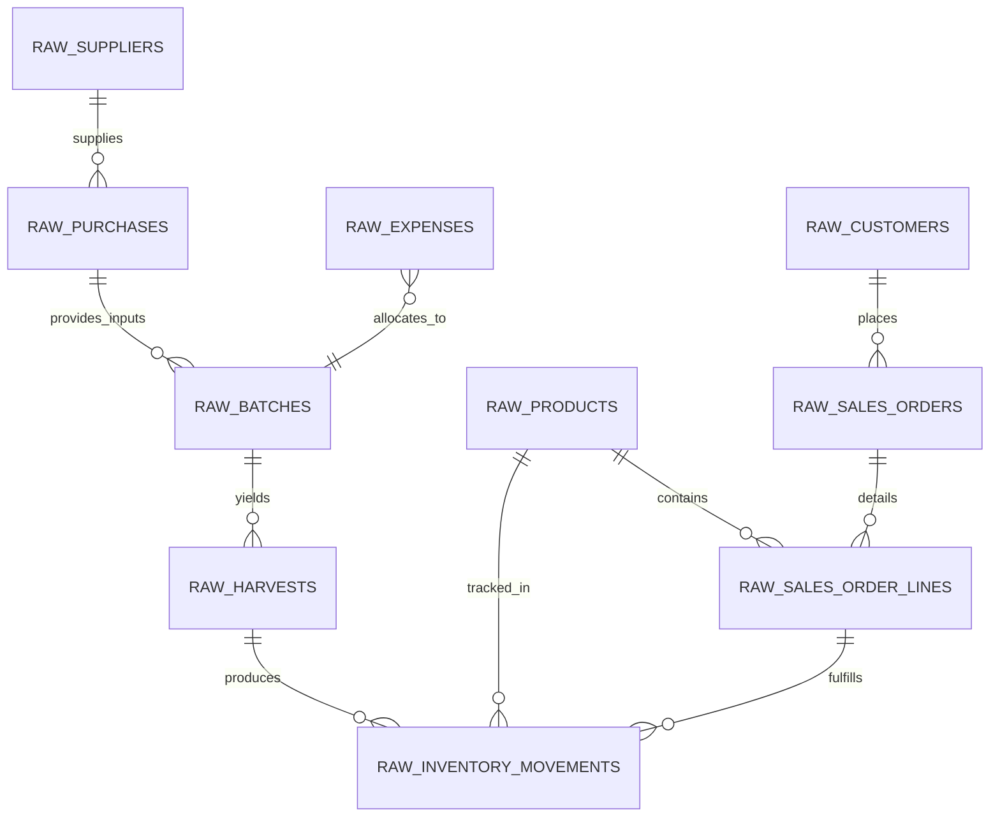
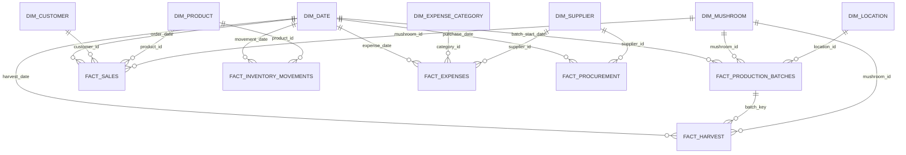

# Dimensional Modeling & Warehouse Schema: MycoMetrics

## 1. Relational Operational Model (`raw` Schema)

The operational database reflects normalized business events as they happen on the farm.

---

## 2. Analytics Dimensional Model (`analytics` Star Schema)

To power high-performance SQL analytics and Power BI dashboards without confusing fan-out or many-to-many pitfalls, data is modeled into a **Kimball Star Schema**:

---

## 3. Dimensional Tables Specification

### `dim_date`
- **Grain**: 1 row per calendar day.
- **Attributes**: `date_key` (INTEGER `YYYYMMDD`), `calendar_date`, `day_of_week`, `day_name`, `is_weekend`, `week_of_year`, `month_number`, `month_name`, `quarter`, `year`, `fiscal_period`.

### `dim_mushroom`
- **Grain**: 1 row per biological mushroom variety.
- **Attributes**: `mushroom_id`, `common_name`, `scientific_name`, `typical_incubation_days`, `target_biological_efficiency`, `standard_shelf_life_days`, `ideal_fruiting_temp_celsius`, `ideal_humidity_pct`.

### `dim_product`
- **Grain**: 1 row per sellable SKU.
- **Attributes**: `product_id`, `mushroom_id`, `sku_code`, `product_name`, `package_format` (Bulk Crate, Clamshell, Kraft Bag), `unit_weight_kg`, `grade` (Grade A, Grade B / Seconds), `standard_selling_price`, `active_status`.

### `dim_customer`
- **Grain**: 1 row per customer account.
- **Attributes**: `customer_id`, `customer_name`, `customer_segment` (Restaurant, Boutique Grocer, Farmers Market, Direct Consumer), `delivery_route_zone`, `payment_terms_days`, `acquisition_date`, `is_active`.

### `dim_supplier`
- **Grain**: 1 row per vendor.
- **Attributes**: `supplier_id`, `supplier_name`, `material_category` (Grain Spawn, Substrate, Packaging, Equipment), `payment_terms_days`, `reliability_rating`.

### `dim_expense_category`
- **Grain**: 1 row per chart-of-accounts expense classification.
- **Attributes**: `category_id`, `category_name`, `cost_behavior` (Direct Production, Variable Operating, Fixed Overhead), `financial_statement_section` (COGS, Operating Expense, CapEx).

### `dim_location`
- **Grain**: 1 row per growing room or storage zone.
- **Attributes**: `location_id`, `location_name` (Grow Room A, Grow Room B, Walk-in Chiller, Incubation Room), `total_rack_capacity_blocks`, `temperature_controlled_flag`.

---

## 4. Fact Tables Specification & Measure Types

| Fact Table Name | Declared Grain | Primary Key | Dimensions Joined | Key Measures | Measure Additivity |
| :--- | :--- | :--- | :--- | :--- | :--- |
| **`fact_production_batches`** | 1 row per production batch | `batch_id` | `dim_date`, `dim_mushroom`, `dim_location` | `dry_substrate_kg`, `spawn_kg`, `total_water_liters`, `planned_blocks_count`, `target_yield_kg`, `cycle_duration_days`, `batch_direct_cost` | Additive across batches; `cycle_duration_days` is Non-additive (averageable). |
| **`fact_harvest`** | 1 row per harvest event (flush per batch) | `harvest_id` | `dim_date`, `dim_mushroom`, `fact_production_batches` | `flush_number`, `gross_harvested_kg`, `accepted_weight_kg`, `rejected_weight_kg`, `harvest_labor_hours` | Fully Additive across all dimensions. |
| **`fact_sales`** | 1 row per sales order line | `order_line_id` | `dim_date`, `dim_customer`, `dim_product`, `dim_mushroom` | `quantity_ordered_kg`, `quantity_fulfilled_kg`, `gross_revenue`, `discount_amount`, `net_revenue`, `cogs_amount`, `gross_profit` | Fully Additive across all dimensions. |
| **`fact_inventory_movements`** | 1 row per stock movement event | `movement_id` | `dim_date`, `dim_product`, `dim_location` | `signed_quantity_kg` (+ for receipt/harvest, - for sale/waste), `unit_valuation`, `total_movement_value` | Fully Additive across transactions; cumulative sum gives stock balance. |
| **`fact_inventory_daily_snapshot`** | 1 row per product per day | `snapshot_date_key` + `product_id` | `dim_date`, `dim_product` | `closing_stock_kg`, `closing_stock_value`, `stock_at_expiry_risk_kg` | Semi-Additive: Additive across products, non-additive across time. |
| **`fact_expenses`** | 1 row per financial expense transaction | `expense_id` | `dim_date`, `dim_expense_category`, `dim_supplier`, `fact_production_batches` | `amount`, `tax_deductible_amount` | Fully Additive across dimensions. |
| **`fact_procurement`** | 1 row per purchase order receipt line | `purchase_id` | `dim_date`, `dim_supplier` | `quantity_ordered`, `quantity_received`, `unit_price`, `total_cost`, `lead_time_days` | Fully Additive for costs and quantities; Lead time is Semi/Non-additive. |

---

## 5. Grain Rules & Multi-Granularity Protection

To prevent the classic Data Analyst trap of "revenue duplication" or "cost fan-out":
- **Never join `fact_harvest` directly to `fact_sales`**: Harvested produce enters inventory as fungible lots. Sales drain inventory. The bridge is `fact_inventory_movements` or aggregated reporting marts.
- **Batch Cost vs. Flush Harvest**: Batch costs (substrate, spawn, preparation labor) occur at the **Batch** grain. Harvest flushes occur at the **Flush** grain. Batch-level yield metrics aggregate flushes first before dividing into batch costs.
