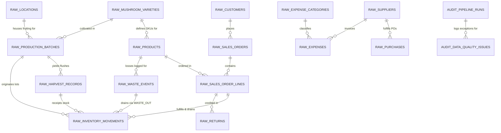

# Entity-Relationship Diagram (ERD) & Database Architecture: MycoMetrics

## 1. Physical Relational Model (`raw` Schema)

The operational database reflects operational reality on the farm. Tables are normalized to capture events as they occur without redundant denormalization.



---

## 2. Table Cardinalities & Relationship Catalog

| Parent Table | Relationship | Child Table | Foreign Key Column | Business Rule & Cascade Policy |
| :--- | :---: | :--- | :--- | :--- |
| `raw_mushroom_varieties` | `1 : N` | `raw_production_batches` | `mushroom_id` | Every batch must specify a valid mushroom variety. |
| `raw_mushroom_varieties` | `1 : N` | `raw_products` | `mushroom_id` | Every finished product SKU maps to an underlying biological variety. |
| `raw_locations` | `1 : N` | `raw_production_batches` | `growing_room_id` | Batches must be assigned to an active growing zone. |
| `raw_production_batches` | `1 : N` | `raw_harvest_records` | `batch_id` | Harvest flushes (Wave 1 & 2) belong to an inoculated batch. |
| `raw_harvest_records` | `1 : N` | `raw_inventory_movements` | `harvest_id` | Accepted harvest generates `HARVEST_IN` lot receipts. |
| `raw_customers` | `1 : N` | `raw_sales_orders` | `customer_id` | Sales orders require an active customer account. |
| `raw_sales_orders` | `1 : N` | `raw_sales_order_lines` | `order_id` | Order lines capture line-item SKU details. |
| `raw_products` | `1 : N` | `raw_sales_order_lines` | `product_id` | Every order line must specify an existing active SKU. |
| `raw_sales_order_lines` | `1 : N` | `raw_returns` | `original_order_line_id` | Customer returns reference eligible fulfilled order lines. |
| `raw_suppliers` | `1 : N` | `raw_purchases` | `supplier_id` | Purchase receipts reference verified registered vendors. |
| `raw_suppliers` | `1 : N` | `raw_expenses` | `supplier_id` | Vendor payments link to vendor accounts when applicable. |
| `raw_expense_categories`| `1 : N` | `raw_expenses` | `expense_category_id` | Expenses must follow chart-of-accounts classifications. |
| `audit_pipeline_runs` | `1 : N` | `audit_data_quality_issues` | `run_id` | Validation errors attach to their parent execution batch. |

---

## 3. Operational Model vs. Dimensional Analytics Model

A fundamental concept in analytics engineering is the distinction between the **Operational Source Model** and the **Dimensional Analytics Model**:

```
OPERATIONAL SOURCE MODEL (3NF)              DIMENSIONAL STAR SCHEMA (KIMBALL)
--------------------------------------      -----------------------------------------
- Optimized for writes, updates & ACID.     - Optimized for reads, BI & aggregations.
- Highly normalized (reduces redundancy).   - De-normalized dimensions + atomic facts.
- Avoids update anomalies.                  - Avoids complex multi-table join bottlenecks.
- Captures granular real-time logistics.    - Clean 1:Many relationships without fan-out.
- Direct reflection of farm spreadsheets.   - Star schema consumed natively by Power BI.
```

### Key Differences:
1. **Grain Alignment**:
   - In `raw`, harvest events occur at the **Flush** grain (`harvest_id`), while batch direct costs occur at the **Batch** grain (`batch_id`).
   - In `analytics`, the intermediate dbt models roll up flush harvests to the batch level before calculating cost per kilogram, preventing duplicate cost multiplication.
2. **Inventory Modeling**:
   - In `raw`, stock is purely transactional: signed movements (`HARVEST_IN` positive, `SALE_OUT` negative, `WASTE_OUT` negative).
   - In `analytics`, we maintain both transactional movements (`fact_inventory_movements`) and periodic point-in-time balances (`fact_inventory_daily_snapshot`) for fast shelf-life and aging calculations.
3. **Financial Accounting Standards**:
   - All monetary amounts use `NUMERIC(10,2)` or `NUMERIC(10,4)` rather than floating-point numbers (`FLOAT`/`REAL`) to prevent IEEE-754 binary rounding discrepancies in financial reporting.

---

## 4. Physical Storage & Indexing Strategy

To maintain sub-second query performance as the business scales, the following indexes are implemented:

1. **Temporal Clustering**:
   - `idx_batches_start_date`, `idx_harvest_date`, `idx_orders_order_date`, `idx_movements_date`, `idx_expenses_date`.
   - Justification: Over 90% of business questions involve date slicing, month-over-month comparisons, or cohort observation windows.
2. **Relational Join Acceleration**:
   - `idx_harvest_batch_id`, `idx_order_lines_order_id`, `idx_order_lines_product_id`, `idx_movements_lot_id`.
   - Justification: Accelerates foreign key lookups and hash joins between fact tables and dimensions.
3. **Idempotent Ingestion Verification**:
   - `idx_*_fingerprint` across all raw tables.
   - Justification: Enables rapid checking of SHA-256 row fingerprints during incremental ingestion to discard duplicate records before committing.
