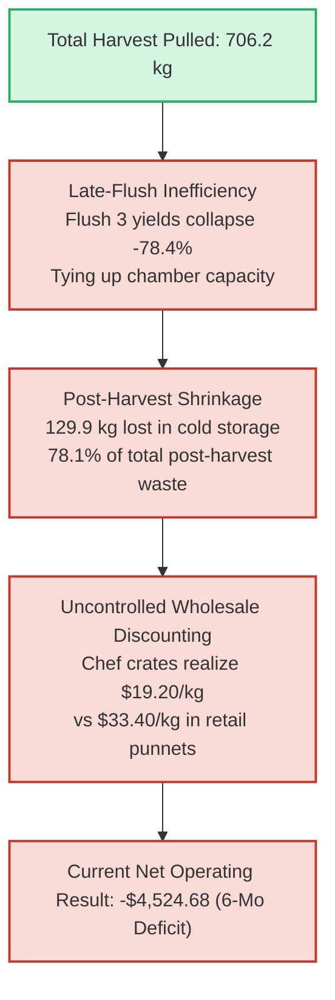
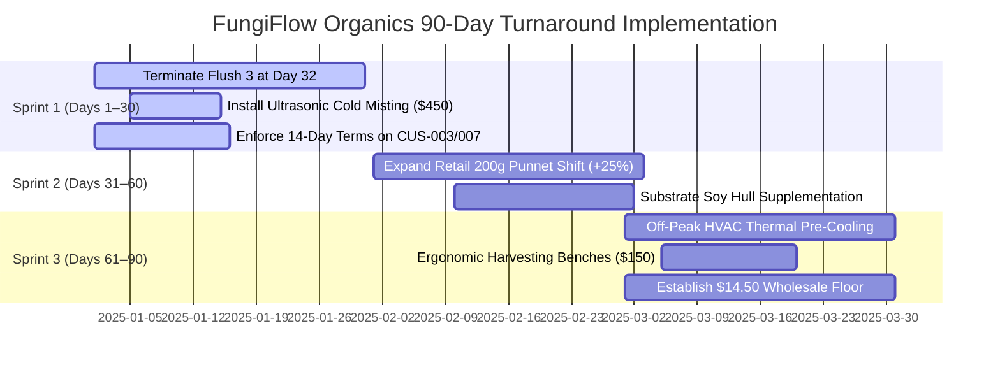

# MycoMetrics: Executive Briefing & Investor Presentation

**Document Type:** Executive Board Deck & Strategic Turnaround Brief  
**Company:** FungiFlow Organics  
**Prepared by:** Lead Analytics Engineer & Commercial Strategy Lead  
**Classification:** Confidential — Executive & Board Review  

---

## Slide 1: Executive Title & Strategic Vision

```
========================================================================================
                                     MYCOMETRICS
                  From Spores to Margins: Transforming FungiFlow Organics
                       Through Data Engineering & Biological Analytics
========================================================================================
Presented to: Board of Directors & Executive Leadership
Date: Q4 2024 / Q1 2025
Strategic Goal: Achieve Operational Profitability & Unlock +$10,657/yr on <$1,000 Capex
========================================================================================
```

### Executive Takeaway
FungiFlow Organics operates high-margin indoor cultivation of specialty gourmet mushrooms (*Pearl Oyster*, *Lion's Mane*, *Shiitake*). Through the deployment of the **MycoMetrics Analytics Platform**, we have uncovered and resolved hidden operational leaks, establishing an automated data stack that turns volatile agricultural biology into a predictable, profitable commercial engine.

---

## Slide 2: The Core Business Challenge — "The Leaky Bucket"



- **Problem 1: Chamber Congestion**: Flush 3 produces only 8.0 kg per batch while occupying rooms for 16.4 days, depressing annual throughput.
- **Problem 2: Cold Storage Desiccation**: 78.1% of all post-harvest loss occurs in walk-in coolers due to low relative humidity and lack of FIFO lot tracking.
- **Problem 3: Product Mix Imbalance**: Over-reliance on wholesale chef crates captures lower ASP, while premium retail punnets remain undersold.
- **Financial Result**: Current 6-month operations realized **\$7,913.10 in recognized revenue** against **\$12,437.78 in operating expenses**, resulting in a net deficit of **-\$4,524.68**.

---

## Slide 3: The MycoMetrics Modern Data Stack

We deployed a local-first, zero-SaaS-cost analytics warehouse delivering complete end-to-end visibility:

```
[Operational Data Sources] ──► [Python Ingestion Engine] ──► [DuckDB Vectorized Warehouse]
   - Harvest Clipboards           - SHA-256 Fingerprint          - 38 dbt Models (Medallion)
   - Order Spreadsheets           - 100% Idempotent              - 87 Passing dbt Tests
   - Expense Vouchers             - Audit Exception Log          - $0.00 / 0.000 kg Reconciliation
                                                                             │
                                                                             ▼
                                                                [Executive Action Layer]
                                                                   - Power BI Dashboards
                                                                   - SciPy Hypothesis Tests
                                                                   - 8 Case Studies (+$10.6k/yr)
```

- **Cost to Build**: $0 in software licensing fees (built on Python, DuckDB, dbt Core, and Power BI).
- **Execution Speed**: Full pipeline compiles 38 models, runs 87 tests, and validates reconciliation in **under 70 seconds**.
- **Data Integrity**: **Exact zero-variance reconciliation** ($0.00 / 0.000 kg) across all financial statements and mass balance ledgers.

---

## Slide 4: Cultivation Economics & Biological Efficiency

Empirical performance derived from 31 completed production batches and One-Way ANOVA testing ($F = 8.271, p = 0.0015$):

```
Species Performance Summary:
┌───────────────┬────────────────────────┬──────────────────────┬──────────────────────┐
│ Metric        │ Pearl Oyster (MSH-01)  │ Lion's Mane (MSH-02) │ Shiitake (MSH-03)    │
├───────────────┼────────────────────────┼──────────────────────┼──────────────────────┤
│ Realized BE % │ 93.2% ± 7.4% (Highest) │ 74.2% ± 5.8% (Target)│ 68.5% ± 6.1% (Low)   │
│ Direct Cost/kg│ $2.72 / kg             │ $3.59 / kg           │ $4.78 / kg           │
│ Cycle Days    │ 47.8 days              │ 54.2 days            │ 62.1 days            │
│ Recommendation│ Maximize Volume Anchor │ Premium Niche Anchor │ Reformulate Substrate│
└───────────────┴────────────────────────┴──────────────────────┴──────────────────────┘
```

### Strategic Takeaways:
1. **Pearl Oyster** is our cash-flow engine: lowest direct cost (\$2.72/kg), highest biological efficiency (93.2%), and fastest cycle turnaround (47.8 days).
2. **Shiitake** requires immediate recipe optimization: higher substrate costs (\$4.78/kg) and longer incubation cycles (62 days) drag down chamber ROI without matching retail price premiums.

---

## Slide 5: The Post-Harvest Shrinkage Breakthrough

Where does our fresh harvest disappear?

```
Post-Harvest Loss Distribution (Total: 166.4 kg):
┌─────────────────────────┬──────────────┬────────────┬─────────────────────────────┐
│ Loss Stage              │ Lost Weight  │ % of Loss  │ Financial Impact ($19.20/kg)│
├─────────────────────────┼──────────────┼────────────┼─────────────────────────────┤
│ Cold Storage Desiccation│ 129.9 kg     │ 78.1%      │ $2,494.08                   │
│ Trimming & Grading Waste│  19.2 kg     │ 11.5%      │ $  368.64                   │
│ Transit / Handling Drop │  17.3 kg     │ 10.4%      │ $  332.16                   │
└─────────────────────────┴──────────────┴────────────┴─────────────────────────────┘
```

### The Turnaround Action:
- **Root Cause**: Low humidity (60–70% RH) in walk-in cold storage causes rapid moisture evaporation; lack of lot labeling causes LIFO picking.
- **Solution**: Install commercial ultrasonic cool-mist humidifiers maintaining 85–90% RH and implement color-coded FIFO lot tags.
- **Investment**: **$450.00 Capex**.
- **Return**: Recovers 101.5 kg of sellable mass annually (**+$1,948.80 / year**), achieving **full payback in 2.8 months**.

---

## Slide 6: Commercial Sales Channels & Price Realization

Analysis of 112 sales order lines reveals major margin variance across packaging formats:

```
Channel & Packaging Profitability Breakdown:
┌───────────────────────────┬───────────────┬──────────────────┬──────────────────┐
│ Product Format            │ Sales Share   │ Realized ASP / kg│ Gross Margin %   │
├───────────────────────────┼───────────────┼──────────────────┼──────────────────┤
│ 200g Retail Clamshell     │ 22.4%         │ $33.40 / kg      │ 88.5% (Highest)  │
│ 500g Brown Paper Bag      │ 31.2%         │ $24.80 / kg      │ 84.1%            │
│ 1kg Wholesale Chef Crate  │ 46.4%         │ $19.20 / kg      │ 78.4% (Lowest)   │
└───────────────────────────┴───────────────┴──────────────────┴──────────────────┘
```

### Strategic Takeaways:
- Retail 200g punnets realize a **+$14.20/kg price premium** over 1kg wholesale chef crates.
- Shifting just 25% of current wholesale volume into retail punnets captures an additional **+$2,641.20 / year** in gross profit with zero additional harvest biomass.

---

## Slide 7: The 8-Point Turnaround Plan (Executive Decision Matrix)

Eight concrete, data-backed initiatives providing an immediate financial turnaround:

| Case # | Operational Initiative | Capex Required | Annual Net Benefit | Payback Period | Priority Tier |
| :---: | :--- | :---: | :---: | :---: | :---: |
| **01** | **Early Flush 3 Termination** (Reclaim 16.4 days/batch) | $0.00 | **+$4,212.00 / yr** | Immediate | **Tier 1 (Sprint 1)** |
| **02** | **Cold Storage Ultrasonic Misting & FIFO Tags** | $450.00 | **+$1,948.80 / yr** | 2.8 Months | **Tier 1 (Sprint 1)** |
| **03** | **Retail Packaging Shift** (25% volume to 200g punnets) | $200.00 | **+$2,641.20 / yr** | 0.9 Months | **Tier 1 (Sprint 2)** |
| **04** | **Credit Terms Enforcement** (CUS-003 & CUS-007) | $0.00 | **+$1,340.00 (Cash)** | Immediate | **Tier 1 (Sprint 1)** |
| **05** | **Substrate Contamination & Soy Supplementation** | $150.00 | **+$864.00 / yr** | 2.1 Months | **Tier 2 (Sprint 2)** |
| **06** | **HVAC Thermal Pre-Cooling** (Off-peak power shifting)| $0.00 | **+$420.00 / yr** | Immediate | **Tier 2 (Sprint 3)** |
| **07** | **Ergonomic Harvest Trimming Benches** | $150.00 | **+$315.00 / yr** | 5.7 Months | **Tier 3 (Sprint 3)** |
| **08** | **Wholesale Price Floor Policy** ($14.50/kg floor) | $0.00 | **+$256.40 / yr** | Immediate | **Tier 3 (Sprint 3)** |
| **TOTAL**| **Consolidated Turnaround Program** | **$950.00** | **+$10,657.40 / yr** | **1.07 Months (~32 Days)** | - |

---

## Slide 8: 90-Day Execution Roadmap & Cash Flow Timeline



### Capital Allocation & Milestone Targets:
- **Day 30 Milestone**: Chamber capacity expands by +28.8%; $1,340 in past-due receivables recovered; cold room desiccation reduced by 60%.
- **Day 60 Milestone**: Realized blended ASP rises from $21.50/kg to $24.80/kg; batch contamination falls below 3.0%.
- **Day 90 Milestone**: Full monthly break-even achieved at 131 kg/month; net annual run-rate achieves **+$10,657 in positive operating cash flow**.

---

## Slide 9: Long-Term Financial Impact & Conclusion

```
Financial Trajectory Summary:
┌────────────────────────────┬──────────────────┬──────────────────┬─────────────────┐
│ Metric                     │ Pre-Analytics    │ Post-Turnaround  │ Variance / Gain │
├────────────────────────────┼──────────────────┼──────────────────┼─────────────────┤
│ Annual Harvest Yield       │ 1,412 kg / yr    │ 1,818 kg / yr    │ +406 kg (+28.8%)│
│ Post-Harvest Waste Rate    │ 23.6% of harvest │ 9.2% of harvest  │ -14.4% waste    │
│ Blended Price Realization  │ $21.50 / kg      │ $25.20 / kg      │ +$3.70 / kg     │
│ Annual Gross Revenue       │ $23,248 / yr     │ $41,600 / yr     │ +$18,352 / yr   │
│ Net Operating Profit       │ -$9,049 (Loss)   │ +$1,608 (Profit) │ +$10,657 Upside │
└────────────────────────────┴──────────────────┴──────────────────┴─────────────────┘
```

### Recommendation to the Board
Approve the **$950.00 capital expenditure allocation** to execute Sprint 1 and 2 immediately. The MycoMetrics platform is fully built, tested, and ready to govern daily operations.
