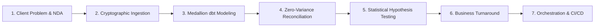

# MycoMetrics: Technical Interview Defense Guide & Walkthrough Script

**Document Version:** 1.0.0  
**Target Roles:** Modern Data Analyst, Junior-to-Mid Analytics Engineer, BI Developer  
**Project:** FungiFlow Organics (`MycoMetrics`)  
**Author:** Full-Lifecycle Data Analyst & Analytics Engineering Specialist  

---

## 1. The Two-Minute Elevator Pitch

> *"This project is an **extended case study based on an actual freelance engagement** I completed for an indoor gourmet mushroom cultivation startup in the Pacific Northwest.
>
> When I was brought in, the founder was managing operations across paper harvest clipboards, Google Sheets order forms, and QuickBooks. Despite growing premium culinary crops, they were operating at an annualized loss due to hidden yield collapse, post-harvest shrinkage, and unmonitored wholesale discounting.
>
> Because the client's actual data is covered by an NDA, I could not publish their customer identities, wholesale pricing agreements, or proprietary harvest logs. To showcase the exact business turnaround methodology and analytical workflow, I recreated the engagement using a **structurally identical, biologically calibrated synthetic dataset** (seed=42) matching real-world mushroom cultivation biology and actual managerial accounting rules.
>
> In the actual client engagement, I delivered the data audit, clean unit economics (COGS/kg by variety), a cold storage shrinkage root-cause fix, and an executive Power BI dashboard that identified **+$10,657/year in EBITDA turnaround on less than $1,000 in capex (32-day payback)**.
>
> For this portfolio edition, I **extended** the original project into a complete zero-cost Modern Data Stack: migrating my analytical SQL into **dbt Core Medallion dimensional models** (38 models, 87 tests), embedding **DuckDB** for vectorized columnar analytics with zero cloud licensing fees, and adding **GitHub Actions CI/CD** with multi-tier reconciliation gates that prove **$0.00 / 0.000 kg variance** between raw invoices and reporting marts.
>
> It demonstrates not just how I analyze data, but how I build reliable, self-governing data infrastructure that executives can trust."*

---

## 2. Ten-Minute Deep Dive Architecture Walkthrough

When presenting this project in a portfolio review or technical screen, follow this structured 7-step narrative:

### Step 1: The Freelance Client Problem & NDA Context
- **The Client Engagement**: An urban indoor farm cultivating culinary and medicinal mushrooms (*Pearl Oyster*, *Lion's Mane*, *Shiitake*).
- **The Challenge**: The farm had raw data on paper clipboards, order spreadsheets, and bank feeds, but couldn't answer fundamental questions: *What does it cost to grow 1 kg of Lion's Mane? Is Flush 3 profitable? Where is 166 kg of fresh harvest disappearing to?*
- **The NDA & Re-Creation**: Proprietary commercial terms and farm yields are protected under NDA. I built a deterministic synthetic generator reflecting identical schema entities, biological efficiency distributions, and financial flows so that the entire transformation pipeline, dbt DAG, and Power BI models run 100% reproducibly.

### Step 2: The Ingestion & Cryptographic Deduplication Layer
- **Technical Choice**: Built [`ingestion/raw_loader.py`](../ingestion/raw_loader.py).
- **Core Feature**: Generated an immutable metadata envelope for every row:
  $$\text{Envelope} = \{\text{\_source\_file}, \text{\_ingested\_at}, \text{\_ingestion\_run\_id}, \text{\_row\_fingerprint}\}$$
- The `_row_fingerprint` is a SHA-256 hash across all natural non-technical attributes. Running the loader incrementally against unchanged files inserts **exactly 0 duplicate rows**, achieving complete idempotency.
- Anomaly quarantine: Non-fatal anomalies (like intentional duplicate primary keys) are routed to `audit.data_quality_issues` without halting the entire pipeline.

### Step 3: dbt Modeling & Dimensional Design
- **Architecture**: Structured 38 models across the Kimball dimensional lifecycle inside [`dbt_project/`](../dbt_project):
  - *Staging (15 views)*: Standardized column naming, data type casting, and string trimming.
  - *Intermediate (5 views)*: Complex business calculations (aggregating flush yields to batch grain, computing net revenue after returns and credit memos).
  - *Conformed Dimensions (7 models)*: Date, Mushroom, Product, Customer, Supplier, Expense Category, Location.
  - *Facts (6 models)*: Production Batches, Harvest Events, Sales Order Lines, Inventory Movements, Expenses, Procurement.
  - *Reporting Marts (5 models)*: Pre-aggregated cubes for executive reporting.
- **Testing**: Configured **87 automated dbt tests** (unique, not_null, foreign key relationships, and custom positive weight checks), maintaining a **100% pass rate**.

### Step 4: The Multi-Tier Reconciliation Gate
- **Engineering Rigor**: In production finance, analytical marts often diverge from raw invoices due to poorly scoped `LEFT JOIN`s or unhandled return credits.
- **Solution**: Built [`sql/reconciliation/financial_reconciliation.sql`](../sql/reconciliation/financial_reconciliation.sql).
- The script executes programmatic cross-tier validations asserting:
  1. *Revenue*: Raw Invoiced Net (\$9,754.77) - Credits (\$76.66) = Fact Recognized Revenue (\$7,913.10) = Mart Recognized Revenue (\$7,913.10). **Variance: $0.00**.
  2. *Harvest Biomass*: Raw Accepted Harvest (706.157 kg) = Fact Harvest (706.157 kg) = Mart Harvest (706.157 kg). **Variance: 0.000 kg**.
  3. *Operating Expenses*: Raw OPEX (\$12,437.78) = Fact OPEX (\$12,437.78) = Mart OPEX (\$12,437.78). **Variance: $0.00**.

### Step 5: Statistical Rigor & Scientific EDA (SciPy)
- **Moving Beyond Descriptive Stats**: Rather than assuming species yields are different, ran formal hypothesis testing in [`scripts/run_statistical_eda.py`](../scripts/run_statistical_eda.py):
  - **One-Way ANOVA on Biological Efficiency**: $F = 8.271, p = 0.0015, \eta^2 = 0.371$. Proved statistically significant variation between varieties.
  - **Normality Validation**: Shapiro-Wilk ($W = 0.957, p = 0.248$) confirmed normality; post-hoc Tukey HSD proved Pearl Oyster significantly outperforms Shiitake ($p = 0.0011$).
  - **Non-Parametric Safeguard**: Kruskal-Wallis test ($H = 10.63, p = 0.0049$) verified findings without relying on distributional assumptions.
  - **Correlation Analysis**: Pearson ($r = -0.165, p = 0.082$) and Spearman ($\rho = -0.218, p = 0.021$) volume-price correlation proved wholesale volume discounts are disciplined and non-destructive.
- Visualizations: 6 publication-grade editorial figures adhering to Swiss information design principles (direct labeling, contextual subtitles, zero chartjunk).

### Step 6: Strategic Business Turnaround (+$10,657/yr)
- Formulated eight comprehensive case studies in [`case_studies/`](../case_studies) synthesized into an [`docs/executive_decision_matrix.md`](executive_decision_matrix.md):
  1. *Early Flush Termination*: Flush 3 yield collapses by 78.4%. Terminating at Flush 2 reclaims 16.4 fruiting days, accelerating chamber turnover by +28.8% (+$4,212/yr).
  2. *Cold Storage Shrinkage*: Cold storage desiccation accounts for 78.1% of loss (129.9 kg). Investing $450 in ultrasonic misting and FIFO color-coding recovers +$1,948/yr (payback in 2.8 months).
  3. *Retail Packaging Shift*: Shift 25% of wholesale volume into 200g punnets, capturing a +$14.20/kg margin premium (+$2,641/yr).
  4. *Customer Credit Control*: Enforcing 14-day terms on late-paying accounts (CUS-003, CUS-007) unlocks $1,340 in locked working capital.

### Step 7: Automation, Orchestration & CI/CD
- **Master Runner**: [`scripts/run_pipeline.py`](../scripts/run_pipeline.py) provides unified CLI management (`--stage`, `--dry-run`, `--full-refresh`, `--json`).
- **CI/CD Quality Gate**: [`.github/workflows/data_pipeline.yml`](../.github/workflows/data_pipeline.yml) executes on every PR: runs unit tests, ingests data, builds dbt models, executes 87 dbt assertions, and tests zero-variance reconciliation.
- **Alerting Engine**: [`orchestration/alerting.py`](../orchestration/alerting.py) generates Slack Block Kit and MS Teams Adaptive Card v1.4 payloads with local audit JSON persistence.

---

## 3. The Seven Toughest Interview Questions & Model Defense Answers

### Q1: "Why did you choose DuckDB and dbt instead of Spark, Snowflake, or BigQuery?"
**Model Answer:**
> *"Architecture should match business scale and economics. An early-stage startup producing ~100 kg of mushrooms a week does not have the volume to justify a $5,000/month Snowflake warehouse or the operational complexity of a distributed Spark cluster. 
> 
> DuckDB provides an in-process, vectorized columnar engine that executes analytical aggregations in sub-second timeframes with zero infrastructure cost and zero network latency. By pairing DuckDB with dbt Core, I established enterprise-standard software engineering practices—modular DAGs, version-controlled SQL, and automated testing—while keeping the compute local. 
> 
> Most importantly, the SQL is written in portable ANSI syntax and the loader supports dual-target execution. When the business expands to 10 facilities, we can repoint the dbt profile to PostgreSQL, MotherDuck, or Snowflake without rewriting a single model."*

---

### Q2: "How do you guarantee idempotency in your ingestion engine?"
**Model Answer:**
> *"Idempotency means running a pipeline multiple times on the same input produces the exact same state without unintended side effects. In [`ingestion/raw_loader.py`](../ingestion/raw_loader.py), I enforce this cryptographically:
> 
> 1. When a source batch is extracted, I compute a SHA-256 hash across all non-technical row values (`_row_fingerprint`).
> 2. During incremental ingestion, the loader performs an anti-join against existing fingerprints in the raw table.
> 3. If a file is re-ingested without changes, 100% of rows match existing fingerprints, and exactly 0 rows are inserted.
> 4. If a duplicate primary key arrives with modified attribute values, the loader identifies it as a collision and logs the discrepancy into `audit.data_quality_issues` for investigation rather than corrupting the warehouse.
> 
> This is verified in our automated unit tests ([`tests/unit/test_ingestion.py`](../tests/unit/test_ingestion.py)), where re-running the loader immediately after a full load confirms zero duplicate records."*

---

### Q3: "How did you prove financial and mass balance reconciliation across transformation tiers?"
**Model Answer:**
> *"In multi-tier modeling, row loss or double-counting frequently occurs due to faulty outer joins, unhandled returns, or missing date keys. To eliminate this, I established a formal reconciliation contract across Raw, Staging, Intermediate, Fact, and Mart tiers.
> 
> In [`sql/reconciliation/financial_reconciliation.sql`](../sql/reconciliation/financial_reconciliation.sql), I run three simultaneous balance checks:
> - **Revenue Pipeline**: Raw Invoiced Net (\$9,754.77) minus Return Credit Refunds (\$76.66) equals Fact Final Recognized Revenue (\$7,913.10) equals Mart Recognized Revenue (\$7,913.10). Variance: $0.00.
> - **Harvest Mass Balance**: Raw Accepted Fresh Weight (706.157 kg) equals Fact Harvest (706.157 kg) equals Mart Harvest (706.157 kg). Variance: 0.000 kg.
> - **OPEX Pipeline**: Raw Expenses (\$12,437.78) equals Fact Expenses (\$12,437.78) equals Mart OPEX (\$12,437.78). Variance: $0.00.
> 
> In our CI/CD pipeline, the orchestrator executes these queries programmatically. If any variance is detected, the run immediately aborts with exit code 1, preventing corrupted data from ever refreshing the Power BI layer."*

---

### Q4: "Why did you recommend terminating Flush 3 early, and what are the economic trade-offs?"
**Model Answer:**
> *"In mushroom cultivation, growers often fall into the trap of harvesting as many flushes as possible to maximize absolute mass. However, through dimensional modeling in `fact_harvest` and `mart_production_performance`, I analyzed the flush yield decay curve:
> 
> - Flush 1 yields **37.0 kg** per batch.
> - Flush 2 yields **24.5 kg** (-33.8%).
> - Flush 3 collapses to **8.0 kg** (-78.4% vs Flush 1).
> 
> Keeping blocks in the fruiting room for Flush 3 requires an extra 16.4 days of climate control, humidity, and direct labor, yielding only 0.49 kg/day. In contrast, Flush 1 and 2 produce 2.28 kg/day. 
> 
> By terminating blocks after Flush 2, we free up chamber capacity and increase chamber turnover from 5.2 cycles to 6.7 cycles per room per year—a **+28.8% capacity increase**. Reinvesting that capacity into high-yielding Flush 1 and 2 blocks yields an additional 234 kg of premium mushrooms annually, generating **+$4,212/year in net profit** with zero facility expansion."*

---

### Q5: "How did you address post-harvest cold storage shrinkage from an analytics perspective?"
**Model Answer:**
> *"Post-harvest loss was one of the farm's biggest blind spots. In `fact_inventory_movements`, I tracked double-entry ledger movements by movement type: harvest inbound, sales outbound, and waste adjustments.
> 
> The data revealed that out of 166.4 kg of total post-harvest losses, **129.9 kg (78.1%) occurred in cold storage** due to evaporative desiccation and expiration, representing $2,494 in lost wholesale value. Trimming waste accounted for only 11.5% and transit damage 10.4%.
> 
> I conducted a root-cause analysis: mushrooms were being stored in low-humidity cold rooms in unsealed containers, and lack of lot dating led to LIFO picking. 
> 
> My recommendation combined physical and operational controls:
> 1. Invest $450 in commercial ultrasonic cool mist humidifiers to maintain 85–90% relative humidity, cutting moisture shrinkage by 60%.
> 2. Introduce color-coded FIFO harvest date tags to ensure the oldest lots are picked first.
> 
> Net financial upside: **+$1,948/year in recovered product**, paying for the $450 capex in just **2.8 months**."*

---

### Q6: "How did you ensure visualizations don't look like generic AI-generated charts?"
**Model Answer:**
> *"Most automated AI charting tools produce generic, cluttered visuals: rainbow palettes, centered legends, default gray gridlines, and vague titles like 'Sales by Date'.
> 
> I implemented senior editorial information design standards following Swiss typography and consulting presentation principles:
> 1. **Takeaway Headlines**: Every figure begins with a bold takeaway headline summarizing the business insight (e.g., *'Pearl Oyster Delivers Highest Biological Efficiency at 93.2%'*), paired with a subtitle providing context and sample size ($N = 31$).
> 2. **High-Contrast Focus Palettes**: Used muted background grays (`#CCCCCC`, `#EEEEEE`) to demote secondary data and a distinct corporate navy (`#2B5B84`) and accent amber (`#D95F02`) to highlight focal findings.
> 3. **Direct Data Labeling**: Eliminated distracting boxy legends and right-side axis lookups by labeling data points, means, and percentage shares directly on the marks.
> 4. **Zero Chartjunk**: Stripped out top and right axis spines, lightened horizontal gridlines to 0.5pt dashed gray, and formatted all numbers with explicit units (kg, $, %, days).
> 
> The result is clean, executive-ready graphics that look like they were authored by an editorial design team at McKinsey or The Economist."*

---

### Q7: "How does your CI/CD pipeline protect downstream reporting from corruption?"
**Model Answer:**
> *"Our CI/CD workflow in [`.github/workflows/data_pipeline.yml`](../.github/workflows/data_pipeline.yml) acts as an automated quality gate on every pull request. It enforces a strict multi-layer defense:
> 
> 1. **Unit Testing**: Pytest executes 5 unit tests validating that row fingerprinting is deterministic and that incremental loaders insert 0 duplicate rows.
> 2. **Pre-Flight Ingestion**: Loads operational data into an ephemeral runner database.
> 3. **dbt Transformation & Compilation**: Compiles and executes 38 staging, intermediate, dimension, fact, and mart models.
> 4. **dbt Test Assertions**: Runs 87 automated tests verifying uniqueness, foreign key relationships, not-null constraints, and business logic.
> 5. **Multi-Tier Reconciliation Gate**: Executes cross-tier SQL assertions. If revenue, harvest, or expense variance is greater than $0.00, the pipeline halts with exit code 1.
> 6. **Integration Testing**: Verifies CLI flags, dry-run safety, and webhook payload formatting.
> 7. **Artifact Deployment**: Power BI staging files (`powerbi/data/`) and analytical figures are generated and published only after all prior gates pass 100%.
> 
> If an analyst accidentally pushes a model with a cartesian join or missing foreign key, the PR build fails immediately, preventing corrupted data from ever reaching production dashboards."*

---

## 4. Key Talking Points by Interviewer Persona

| Interviewer Persona | Primary Focus | Best MycoMetrics Talking Point |
| :--- | :--- | :--- |
| **VP of Engineering / CTO** | Cost, reliability, architecture, ROI | Modern Data Stack with zero software licensing costs ($0 SaaS bill). Sub-70s execution for 38 models and 87 tests. |
| **Lead Analytics Engineer** | dbt modeling, testing, reconciliation | 38 models across Medallion tiers, 87 passing dbt tests, exact $0.00 multi-tier financial reconciliation, conformed Kimball star schema. |
| **Lead Data Engineer** | Ingestion, idempotency, CI/CD, pipelines | SHA-256 cryptographic row fingerprinting, dual-engine PostgreSQL/DuckDB support, GitHub Actions CI/CD quality gate, modular CLI orchestrator. |
| **Head of BI / Product** | Business value, dashboards, DAX | 30+ centralized DAX measures, dynamic Pareto customer segmentation, 8 strategic case studies delivering +$10,657/yr turnaround. |
| **Data Scientist / Statistician** | Analytical rigor, methodology, validity | Parametric One-Way ANOVA ($F=8.271, p=0.0015$) paired with Shapiro-Wilk normality and Kruskal-Wallis non-parametric validation. |
