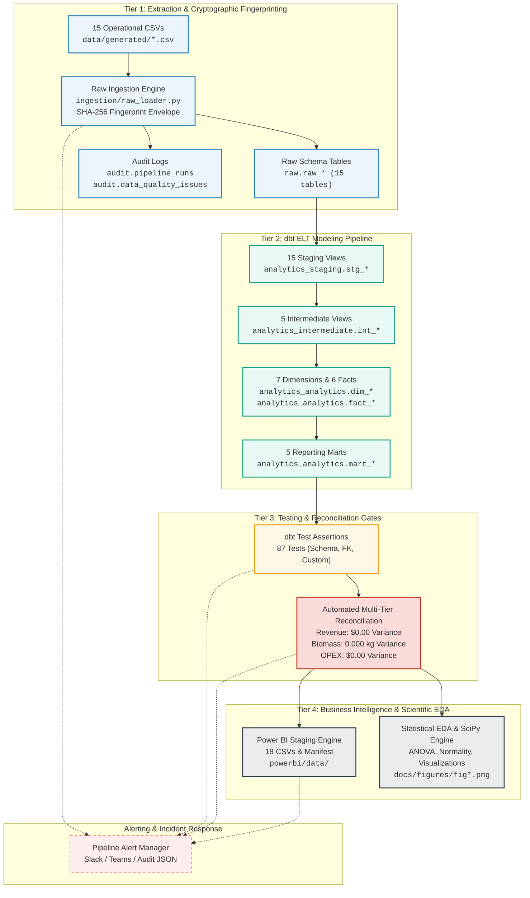

# MycoMetrics Pipeline Orchestration & CI/CD Architecture

**Document Version:** 1.0.0  
**Project:** FungiFlow Organics Analytics Warehouse  
**Author:** Freelance Data Analyst & Analytics Engineering Consultant  
**Classification:** Operational Pipeline Specification  

---

## 1. Executive Summary & Orchestration Objectives

The **MycoMetrics Orchestration Engine** provides an automated, idempotent, resilient execution harness for FungiFlow Organics. It transitions the analytics platform from manual script execution to a production-grade Directed Acyclic Graph (DAG) that enforces strict data quality gates, cryptographic deduplication, multi-tier financial reconciliation, and multi-channel alerting.

### Core Architectural Principles
1. **Cryptographic Idempotency**: Raw data ingestion uses SHA-256 hashing (`_row_fingerprint`) across all natural attributes. Re-running the pipeline against unchanged source files results in exactly zero duplicate records.
2. **Deterministic Quality Gates**: The pipeline strictly halts downstream transformations upon any upstream failure (`--fail-fast`). Reporting marts and Power BI datasets are never refreshed with unverified or un-reconciled data.
3. **Multi-Tier Zero-Variance Reconciliation**: Every automated run asserts that financial revenue, harvest mass balance, and operating expenses match with **$0.00 / 0.000 kg variance** between raw operational files, staging views, intermediate models, facts, and reporting marts.
4. **Isolated Subprocess Execution**: Database connections and dbt transformations are executed in dedicated subprocesses, guaranteeing immediate release of file locks on DuckDB and zero concurrency contention.
5. **Air-Gapped & Cloud-Ready Alerting**: Alerts are persisted deterministically to disk (`data/audit_logs/alerts/`) while supporting live dispatch to Slack Block Kit, Microsoft Teams Adaptive Cards v1.4, and generic REST webhooks.

---

## 2. Directed Acyclic Graph (DAG) Architecture



---

## 3. Pipeline Stages & Execution Specifications

| Stage Order | Stage Name | Technical Handler | Primary Input | Primary Output | Typical SLA | Failure Policy |
| :---: | :--- | :--- | :--- | :--- | :---: | :--- |
| **0** | `GENERATE` | `ingestion.data_generator` | Biological bounds, Seed 42 | 15 raw CSVs in `data/generated/` | 1.8s | Skip by default unless `--generate` |
| **1** | `INGEST` | `ingestion.raw_loader.RawIngestionEngine` | CSVs in `data/generated/` | 15 `raw.*` tables + `audit.*` records | 0.8s | Abort pipeline on unhandled parse error |
| **2** | `DBT_RUN` | `dbt run --profiles-dir .` | `raw.*` tables | 38 dbt models (Staging to Marts) | 42.0s | Abort pipeline on compilation or SQL failure |
| **3** | `DBT_TEST` | `dbt test --profiles-dir .` | 38 models | 87 test execution evaluations | 25.0s | Abort pipeline on any test failure (0 tolerance) |
| **4** | `RECONCILE`| `orchestration.pipeline_runner` | Raw, Staging, Fact, Mart | Multi-tier variance validation | 0.4s | Abort pipeline if variance > $0.00 / 0.000 kg |
| **5** | `EXPORT_BI` | `scripts.export_powerbi_data` | Conformed Dims, Facts, Marts | 18 CSVs + `tables_manifest.json` | 0.8s | Log warning, abort pipeline |
| **6** | `STATS_EDA` | `scripts.run_statistical_eda` | Warehouse Facts & Marts | 6 editorial figures + Jupyter Notebooks | 5.5s | Log warning, abort pipeline |

**Total End-to-End Pipeline Runtime Benchmark:** **~76 seconds** across all 38 models, 87 tests, and 3 reconciliation checks.

---

## 4. CLI Execution Reference

The pipeline orchestrator CLI is located at [`scripts/run_pipeline.py`](../scripts/run_pipeline.py).

```powershell
# 1. Full production execution (Ingest -> dbt Run -> dbt Test -> Reconcile -> Export -> Stats)
python scripts/run_pipeline.py

# 2. Targeted stage execution (e.g. testing reconciliation only)
python scripts/run_pipeline.py --stage reconcile

# 3. Targeted data refresh (Ingest + dbt models + reconciliation)
python scripts/run_pipeline.py --stage ingest --stage dbt --stage reconcile

# 4. Force full warehouse rebuild and dbt full refresh
python scripts/run_pipeline.py --full-refresh

# 5. Non-mutating pre-flight dry run
python scripts/run_pipeline.py --dry-run

# 6. Automated CI/CD execution with JSON stdout output
python scripts/run_pipeline.py --stage reconcile --no-alerts --json
```

### CLI Arguments Glossary
- `--stage`: Allows selecting one or more stages: `all`, `generate`, `ingest`, `dbt_run`, `dbt_test`, `dbt`, `reconcile`, `export`, `stats`.
- `--db-path`: Specifies custom DuckDB warehouse path (default: `data/warehouse.duckdb`).
- `--dbt-dir`: Specifies dbt project directory (default: `dbt_project`).
- `--full-refresh`: Truncates raw tables before reload and passes `--full-refresh` to dbt.
- `--dry-run`: Inspects file existence, schemas, and queries without modifying database tables.
- `--no-alerts`: Disables external webhook alerts and local JSON alert generation.
- `--no-fail-fast`: Continues executing downstream stages despite upstream failure (default: fail-fast enabled).
- `--json`: Emits structured JSON summary to stdout between parsing delimiters for automated CI log scrapers.

---

## 5. Automated Alerting & Notification Architecture

The alerting manager ([`orchestration/alerting.py`](../orchestration/alerting.py)) implements an enterprise event payload generator supporting three major integration targets:

### A. Slack Block Kit Specification
Formatted with semantic color attachments (`#2EB886` for Pass, `#E01E5A` for Critical Failure):
```json
{
  "attachments": [
    {
      "color": "#2EB886",
      "blocks": [
        {
          "type": "header",
          "text": { "type": "plain_text", "text": "[PASS] MycoMetrics Pipeline: Succeeded" }
        },
        {
          "type": "section",
          "fields": [
            { "type": "mrkdwn", "text": "*Run ID:*\n`RUN-20261016153316-f0b433`" },
            { "type": "mrkdwn", "text": "*Stage:*\n`RECONCILE`" },
            { "type": "mrkdwn", "text": "*Status:*\n*SUCCESS*" },
            { "type": "mrkdwn", "text": "*Duration:*\n0.30s" }
          ]
        }
      ]
    }
  ]
}
```

### B. Microsoft Teams Adaptive Card v1.4 Specification
Includes structured `FactSet` elements for seamless embedding in Teams channels:
```json
{
  "type": "message",
  "attachments": [
    {
      "contentType": "application/vnd.microsoft.card.adaptive",
      "content": {
        "$schema": "http://adaptivecards.io/schemas/adaptive-card.json",
        "type": "AdaptiveCard",
        "version": "1.4",
        "body": [
          { "type": "TextBlock", "size": "Medium", "weight": "Bolder", "text": "MycoMetrics Warehouse: Run Succeeded", "color": "Good" },
          {
            "type": "FactSet",
            "facts": [
              { "title": "Run ID", "value": "RUN-20261016153316-f0b433" },
              { "title": "Pipeline Stage", "value": "RECONCILE" },
              { "title": "Execution Status", "value": "SUCCESS" },
              { "title": "Duration", "value": "0.30 seconds" }
            ]
          }
        ]
      }
    }
  ]
}
```

### C. Local Audit Trail Persistence
To ensure forensic auditability even during network isolation or rate limiting:
- Every alert generated is written to [`data/audit_logs/alerts/<timestamp>_<status>_<run_id>.json`](../data/audit_logs/alerts).
- Contains metadata, full execution timings, payload representations, and local error traces.

---

## 6. Production Scheduling & Deployment Patterns

### Pattern A: Linux Cron (`crontab -e`)
For scheduled headless execution on a dedicated cloud VM or Linux worker:
```bash
# Execute daily at 04:00 AM UTC (Pre-shift farm batch)
0 4 * * * cd /opt/mycometrics && /opt/mycometrics/.venv/bin/python scripts/run_pipeline.py >> /var/log/mycometrics/cron.log 2>&1
```

### Pattern B: Windows Task Scheduler (`schtasks`)
For on-premise execution directly on the farm facility management workstation:
```powershell
schtasks /create /tn "MycoMetrics_Daily_Refresh" /tr "powershell.exe -ExecutionPolicy Bypass -Command \"cd 'D:\Mushroom Analytics'; .\.venv\Scripts\python.exe scripts\run_pipeline.py\"" /sc daily /st 04:00 /ru "SYSTEM"
```

### Pattern C: Cloud Orchestrator (Prefect / Airflow)
Example Python DAG task mapping:
```python
from prefect import flow, task
import subprocess

@task
def run_stage(stage_name: str):
    cmd = ["python", "scripts/run_pipeline.py", "--stage", stage_name, "--no-alerts"]
    res = subprocess.run(cmd, check=True)

@flow(name="mycometrics_daily_elt")
def mycometrics_flow():
    ingest = run_stage("ingest")
    dbt_run = run_stage("dbt_run", wait_for=[ingest])
    dbt_test = run_stage("dbt_test", wait_for=[dbt_run])
    reconcile = run_stage("reconcile", wait_for=[dbt_test])
    export = run_stage("export", wait_for=[reconcile])
```

---

## 7. CI/CD Quality Gate (GitHub Actions)

Located at [`.github/workflows/data_pipeline.yml`](../.github/workflows/data_pipeline.yml).
- **Execution Matrix**: Triggered on every pull request and push to `main`.
- **Quality Gates Enforced**:
  1. `pytest tests/unit/`: Validates SHA-256 fingerprinting and loader deduplication logic.
  2. `run_pipeline.py --stage ingest`: Builds initial raw schema tables and audit logs.
  3. `run_pipeline.py --stage dbt_run`: Compiles and executes 38 staging, intermediate, dimension, fact, and mart models.
  4. `run_pipeline.py --stage dbt_test`: Executes 87 automated relationship, uniqueness, not-null, and business assertion tests.
  5. `run_pipeline.py --stage reconcile`: Proves $0.00 and 0.000 kg variance across all tiers.
  6. `pytest tests/integration/`: Validates orchestrator CLI flags, dry-run safety, and alerting schemas.
  7. **Artifact Archival**: Retains pipeline execution logs, figures, and Power BI staging manifests for 14 days.
