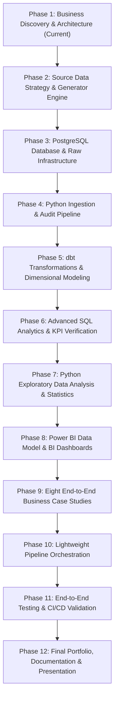

# Project Implementation Roadmap & Checklist: MycoMetrics

## 1. Multi-Phase Implementation Roadmap

The MycoMetrics platform is executed across 12 sequential phases. In accordance with professional engineering standards, each phase has concrete deliverables and acceptance criteria that must be verified before proceeding.

---

## 2. Prioritized Implementation Checklist

- [x] **Phase 1: Business Discovery & Requirements**
  - [x] Document business context, operational realities, and unit economics (`docs/business_model.md`).
  - [x] Map end-to-end operational lifecycle with normal & exception paths (`docs/business_process.md`).
  - [x] Design local-first modern data stack architecture (`docs/architecture.md`).
  - [x] Define hybrid data strategy and provenance tags (`docs/source_data_strategy.md`).
  - [x] Draft dimensional star schema, grain definitions, and fact types (`docs/dimensional_model.md`).
  - [x] Define unified metric and KPI glossary (`docs/kpi_glossary.md`).
  - [x] Map all 8 business case studies to tables and methods (`docs/case_studies_overview.md`).
  - [x] Verify Windows 11 host environment (Python 3.12, Git, Power BI, Disk Space).
  - [x] Define Phase 1 acceptance criteria and sign-off.
- [ ] **Phase 2: Data Creation & Profiling**
  - [ ] Implement deterministic Python data generator with referential integrity (`ingestion/data_generator.py`).
  - [ ] Generate sample raw CSVs and edge cases for all operational domains.
  - [ ] Generate complete data dictionary (`docs/data_dictionary.md`).
  - [ ] Profile generated datasets for missingness, distributions, and boundary constraints.
- [ ] **Phase 3: PostgreSQL Foundation**
  - [ ] Configure database connection and `.env`.
  - [ ] Create DDL scripts for `raw`, `staging`, `analytics`, and `audit` schemas.
  - [ ] Implement relational constraints, primary keys, and foreign keys.
  - [ ] Generate entity relationship diagram (ERD).
- [ ] **Phase 4: Python Ingestion Engine**
  - [ ] Build modular extractors for CSV/Excel with schema validation.
  - [ ] Implement atomic loading into PostgreSQL `raw` tables.
  - [ ] Implement idempotency engine with SHA-256 fingerprinting.
  - [ ] Implement pipeline audit logging table in `audit.pipeline_runs`.
  - [ ] Write unit tests for ingestion and duplicate prevention.
- [ ] **Phase 5: ELT Transformations with dbt Core**
  - [ ] Initialize dbt project with PostgreSQL adapter.
  - [ ] Build staging views (`stg_*`) with standard types and naming.
  - [ ] Build intermediate transformation models (`int_*`) for yield, balance, and cost allocations.
  - [ ] Build dimensional tables (`dim_*`) and fact tables (`fact_*`).
  - [ ] Build business reporting marts (`mart_*`).
  - [ ] Implement dbt generic tests (unique, not_null, accepted_values, relationships) and custom business tests.
  - [ ] Compile and generate dbt documentation and lineage graph.
- [ ] **Phase 6: Advanced SQL Business Analytics**
  - [ ] Develop 15+ production-grade analytical SQL queries utilizing CTEs, window functions (`DENSE_RANK`, `LAG`/`LEAD`, running totals), and conditional aggregations.
  - [ ] Reconcile financial figures against inventory movements.
  - [ ] Package interview-ready SQL scripts with documented business questions, grains, and interpretations.
- [ ] **Phase 7: Python Exploratory Data Analysis & Statistics**
  - [ ] Develop comprehensive Jupyter notebook (`analysis/exploratory_data_analysis.ipynb`).
  - [ ] Statistical distributions, correlation analysis, and confidence intervals.
  - [ ] Yield and cycle time analysis across mushroom varieties.
- [ ] **Phase 8: Power BI Dashboards**
  - [ ] Construct Kimball dimensional model in Power BI with 1:Many relationships.
  - [ ] Write 30+ centralized DAX measures with exact formulas documented.
  - [ ] Design 5 core report pages: Business Overview, Production, Sales, Inventory & Waste, Costs & Profitability.
  - [ ] Validate dashboard visual totals against SQL ground truth.
- [ ] **Phase 9: Eight Business Case Studies**
  - [ ] Execute Case Studies 1 through 8 with dedicated SQL, empirical data outputs, and executive reports.
  - [ ] Formulate evidence-based recommendations with defensible financial impact models.
- [ ] **Phase 10: Lightweight Automation & Pipeline Monitoring**
  - [ ] Build end-to-end Python pipeline runner script with error handling and retry logic.
  - [ ] Implement run freshness and anomaly checks.
- [ ] **Phase 11: Comprehensive Quality Testing & CI/CD**
  - [ ] Write pytest suites for Python extractors, validators, and transformers.
  - [ ] Build GitHub Actions CI workflow for linting, testing, and dbt compilation.
- [ ] **Phase 12: Final Portfolio Documentation & Interview Preparation**
  - [ ] Write comprehensive executive `README.md`.
  - [ ] Document project architecture, data lineage, and runbook.
  - [ ] Prepare resume project bullets and technical interview Q&A guide.

---

## 3. Phase 1 Acceptance Criteria

Phase 1 is complete when all of the following conditions are met:

1. [x] **Business Model Specified**: A detailed description of the mushroom startup (FungiFlow Organics), its varieties (Oyster, Lion's Mane, Shiitake), infrastructure constraints, unit economics, and assumptions is documented.
2. [x] **Operational Process Mapped**: The complete operational lifecycle is diagrammed and tabulated, covering both standard paths (procurement through delivery) and exception paths (contamination, harvest rejection, cold storage spoilage, customer returns).
3. [x] **Architecture Justified**: A Modern Data Stack architecture (Python, PostgreSQL, dbt Core, Power BI) appropriate for an early-stage startup is defined, contrasting with unnecessary enterprise complexity.
4. [x] **Source Data Strategy Established**: Clear taxonomy separating Category A (Operational), Category B (Synthetic Demo), and Category C (Public Reference) with mandatory provenance tagging (`source_type`).
5. [x] **Relational & Dimensional Models Designed**: Detailed schemas for raw tables, staging views, conformed dimensions (`dim_*`), and atomic fact tables (`fact_*`) with explicit grains and additivity rules.
6. [x] **KPI Glossary Defined**: Standardized formulas, units, grains, and limitations for 20+ core business metrics across Production, Sales, Profitability, Inventory, and Customers.
7. [x] **8 Case Studies Mapped**: All eight required case studies mapped to business problems, required datasets, analytical methods, and executive deliverables.
8. [x] **Environment Inspected**: Verified host capabilities on Windows 11 (Python 3.12, Git 2.55, Power BI Desktop, D: drive storage), identifying PostgreSQL setup options.
9. [x] **Prioritized Checklist Published**: Structured roadmap and sequential task plan defined.
10. [x] **Scaffolding Established**: Core workspace directory hierarchy and configuration files (`.env.example`, `.gitignore`, `docs/`) initialized on disk.
