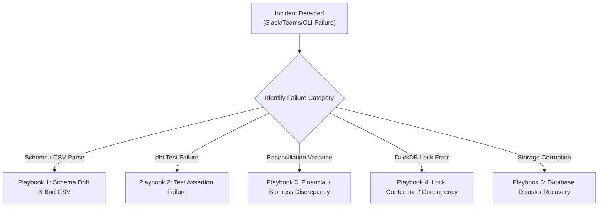

# MycoMetrics Operations Runbook & Incident Response Playbook

**Document Version:** 1.0.0  
**Target Audience:** Data Engineers, Analytics Engineers, On-Call Operations  
**Warehouse Target:** Dual-Engine (PostgreSQL / Embedded DuckDB)  
**Classification:** Standard Operating Procedures (SOP)  

---

## 1. Daily Operations & Routine Maintenance

### 1.1 Routine Daily Ingestion Verification
Every day at 04:00 AM UTC, the automated pipeline refreshes the warehouse. The primary operational health checks are:
1. Verify latest pipeline execution log in [`logs/pipeline_runs/`](file:///d:/Mushroom%20Analytics/logs/pipeline_runs).
2. Check for zero entries in `audit.data_quality_issues` with severity `ERROR` or `CRITICAL`:
   ```sql
   SELECT issue_id, source_file, check_type, severity, issue_description, detected_at
   FROM audit.data_quality_issues
   WHERE severity IN ('ERROR', 'CRITICAL') AND detected_at >= CURRENT_DATE - INTERVAL 1 DAY;
   ```
3. Confirm latest pipeline run status in `audit.pipeline_runs`:
   ```sql
   SELECT run_id, start_time, duration_seconds, status, total_rows_inserted, error_message
   FROM audit.pipeline_runs
   ORDER BY start_time DESC LIMIT 5;
   ```

### 1.2 Triggering Manual Refresh
If a farm manager provides manual mid-day spreadsheets or an ad-hoc operational update is required:
```powershell
# Run incremental ingestion and reporting update
python scripts/run_pipeline.py --stage ingest --stage dbt --stage reconcile --stage export
```

### 1.3 Full Warehouse Rebuild
Used during schema upgrades, major historical data corrections, or disaster recovery:
```powershell
# Truncates raw tables, reloads source CSVs with fresh fingerprinting, and rebuilds all 38 dbt models
python scripts/run_pipeline.py --full-refresh
```

---

## 2. Incident Response Playbooks



---

### Incident Playbook 1: Upstream CSV Schema Drift / Parse Error
**Symptom:** Pipeline halts during `INGEST` stage with error: `KeyError: 'column_name'` or `ValueError: could not convert string to float`.

**Diagnosis:**
1. Open the latest run log in `logs/pipeline_runs/` to identify the failing source file.
2. Inspect the latest uploaded file in `data/generated/` or `data/raw_samples/`.
3. Check header names against `sql/initialization/02_create_raw_tables.sql`.

**Remediation Procedure:**
1. If an optional column was omitted by the farm spreadsheet, update the loader schema map in [`ingestion/raw_loader.py`](file:///d:/Mushroom%20Analytics/ingestion/raw_loader.py) to provide default `None`/`np.nan`.
2. If column headers were misspelled (e.g. `cust_name` instead of `customer_name`), normalize the column in the staging loader.
3. Validate locally:
   ```powershell
   python scripts/run_pipeline.py --stage ingest --dry-run
   python scripts/run_pipeline.py --stage ingest
   ```

---

### Incident Playbook 2: dbt Test Assertion Failure
**Symptom:** Pipeline halts during `DBT_TEST` stage with exit code 1. Alert sent: `Stage [DBT_TEST] Failed`.

**Diagnosis:**
1. Locate the exact failing test name from the terminal output or `dbt_project/target/run_results.json`.
2. Common failure archetypes:
   - `unique_*`: Duplicate primary key generated in staging or fact models.
   - `not_null_*`: Missing mandatory business attribute (e.g. `customer_id` is NULL).
   - `relationships_*`: Foreign key orphan (e.g., an order line references a product not present in `dim_product`).
   - `assert_positive_harvest_weight`: A negative or zero harvest weight was entered in raw data.
3. Query the compiled test SQL located in `dbt_project/target/compiled/mycometrics/models/...` against DuckDB to view the violating rows:
   ```powershell
   & ".\.venv\Scripts\python.exe" -c "
   import duckdb
   con = duckdb.connect('data/warehouse.duckdb')
   print(con.execute('SELECT * FROM analytics_staging.stg_harvest_records WHERE accepted_weight_kg <= 0').df())
   con.close()
   "
   ```

**Remediation Procedure:**
1. If bad upstream data is detected, file an audit entry in `audit.data_quality_issues`.
2. Apply a filtering rule or coalescing logic in the appropriate staging model in `dbt_project/models/staging/`.
3. Re-test specifically:
   ```powershell
   python scripts/run_pipeline.py --stage dbt_test
   ```

---

### Incident Playbook 3: Financial & Volumetric Reconciliation Discrepancy
**Symptom:** Pipeline halts during `RECONCILE` stage. Alert sent: `UNRECONCILED DISCREPANCY [FAIL]`.

**Diagnosis:**
1. The orchestrator tests 3 strict reconciliation rules:
   - `REVENUE_PIPELINE_RECONCILIATION`: Invoiced net revenue vs recognized sales revenue.
   - `HARVEST_MASS_BALANCE_RECONCILIATION`: Raw accepted harvest kg vs fact harvest kg vs mart harvest kg.
   - `OPEX_FINANCIAL_RECONCILIATION`: Raw operating expenses vs fact expenses vs mart expenses.
2. Determine which test failed and inspect the reported variance:
   ```powershell
   python scripts/run_pipeline.py --stage reconcile
   ```
3. Trace the reconciliation breakdown:
   - If Revenue broke: An intermediate refund or credit note (`int_sales_financials`) was calculated without matching line in `fact_sales` or `mart_business_overview`.
   - If Harvest broke: An unaccepted/rejected harvest batch was improperly included or excluded in a join condition.
   - If OPEX broke: An expense row was dropped during category dimensional joining.

**Remediation Procedure:**
1. Run the reconciliation SQL script interactively:
   ```powershell
   & ".\.venv\Scripts\python.exe" scripts/execute_sql_analytics.py
   ```
2. Verify dimensional joins use `LEFT JOIN` to prevent accidental row loss on missing dimensional foreign keys.
3. Confirm variance returns to exactly `$0.00` / `0.000 kg`.

---

### Incident Playbook 4: DuckDB Lock Contention (`IOException: Could not set lock on file`)
**Symptom:** Pipeline fails with: `IOException: Could not set lock on file "data/warehouse.duckdb": Resource temporarily unavailable`.

**Root Cause:**
DuckDB is an embedded database that permits multiple concurrent readers, but requires exclusive write locks. A dangling Python process, Power BI Desktop session, or Jupyter Notebook kernel has the `.duckdb` file open in read-write mode.

**Remediation Procedure:**
1. Identify any active processes holding handles to `warehouse.duckdb`:
   ```powershell
   Get-Process python, PowerBI* | Select-Object Id, ProcessName, Path
   ```
2. Terminate orphaned Python worker processes holding database connections:
   ```powershell
   Stop-Process -Name python -Force -ErrorAction SilentlyContinue
   ```
3. In Power BI Desktop: Close the active session or change the Power BI data source from direct DuckDB connection to the staged CSV directory ([`powerbi/data/`](file:///d:/Mushroom%20Analytics/powerbi/data)), which is read-only and eliminates all lock contention.
4. Retry the pipeline:
   ```powershell
   python scripts/run_pipeline.py --stage reconcile
   ```

---

### Incident Playbook 5: Database Corruption & Disaster Recovery
**Symptom:** DuckDB database file fails integrity checks or crashes with storage corruption.

**Recovery Objective:**
Restore warehouse to 100% operational state within **< 3 minutes** with **zero data loss**, utilizing deterministic source CSVs and reproducible dbt code.

**Disaster Recovery Execution:**
1. **Archive Corrupted File:**
   ```powershell
   Move-Item -Path "data/warehouse.duckdb" -Destination "data/warehouse.duckdb.corrupt.$(Get-Date -Format 'yyyyMMddHHmmss')" -Force
   ```
2. **Execute Full Pipeline Rebuild:**
   ```powershell
   python scripts/run_pipeline.py --full-refresh
   ```
   *Execution Actions:*
   - Initializes clean database schemas (`raw`, `audit`, `analytics_staging`, `analytics_intermediate`, `analytics_analytics`).
   - Extracts and re-fingerprints all 15 operational CSVs.
   - Compiles and materializes all 38 dbt views, dimensions, facts, and marts.
   - Executes all 87 data quality tests.
   - Verifies multi-tier zero-variance reconciliation.
   - Stages fresh Power BI extracts.
3. **Validate Restored State:**
   ```powershell
   pytest tests/ -v
   ```
4. **Notify Stakeholders:**
   The alerting engine automatically dispatches a `SUCCESS` notification to Slack/Teams confirming full restoration.
