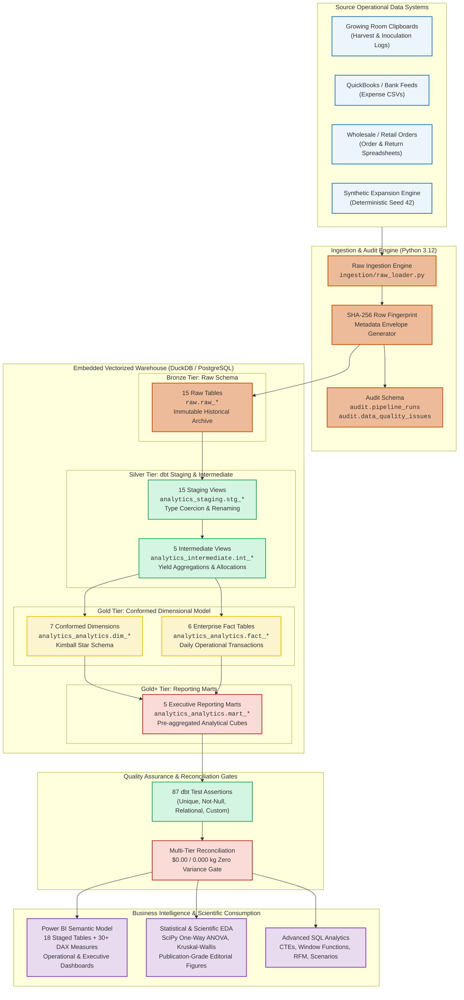

# MycoMetrics Technical Architecture & Engineering Manual

**Document Version:** 1.0.0  
**Project:** FungiFlow Organics Analytics Warehouse  
**Author:** Lead Analytics Engineer & Data Platform Architect  
**Classification:** Engineering Specification  

---

## 1. Architectural Vision & System Topology

The **MycoMetrics Data Platform** is an enterprise-grade, local-first, cloud-portable modern data platform designed specifically for the operational and financial realities of high-value indoor agricultural ventures. Gourmet mushroom cultivation demands strict environmental control, high batch turnover, and tight cash flow management.

The architecture eliminates cloud data platform bloat (avoiding $5k–$20k/month minimum spend on Snowflake/Databricks/Kafka) by using **embedded vectorized SQL engines** (DuckDB) and **industry-standard ELT frameworks** (dbt Core) running on local compute or lightweight container workers, with seamless migration paths to PostgreSQL, MotherDuck, or cloud data warehouses.

---

## 2. Multi-Tier Medallion Architecture

The warehouse follows the industry-standard Medallion Architecture pattern:

| Tier | Schema | Physical Format | Immutability | Core Responsibility |
| :--- | :--- | :--- | :---: | :--- |
| **Bronze (Raw)** | `raw` | Physical Table | Append-Only | Full-fidelity replica of operational files with technical audit metadata envelope. |
| **Silver (Staging)** | `analytics_staging` | Logical View | Derived | Standardizes naming (`snake_case`), casts data types, validates nullability, trims strings. |
| **Silver+ (Intermediate)** | `analytics_intermediate` | Logical View | Derived | Complex multi-table business joins, yield rollups, return net reconciliations, direct cost calculations. |
| **Gold (Core Dimensions)** | `analytics_analytics` | Physical / View | SCD Type 1 | 7 Conformed dimensions providing stable business context (Mushroom, Product, Customer, Supplier, Location, Expense Category, Date). |
| **Gold (Core Facts)** | `analytics_analytics` | Physical / View | Transactional | 6 Fact tables capturing discrete operational events (Batches, Harvests, Sales Lines, Inventory Movements, Expenses, Procurement). |
| **Gold+ (Reporting Marts)** | `analytics_analytics` | Physical / View | Aggregated | 5 Specialized business marts pre-aggregating KPIs for zero-latency dashboard rendering. |
| **Audit & Governance** | `audit` | Physical Table | Append-Only | Pipeline run telemetry, row watermarks, execution duration, and data quality exception logging. |

---

## 3. Dual-Engine Execution & SQL Portability Strategy

To guarantee zero vendor lock-in, the codebase is engineered for dual compatibility between **PostgreSQL 16+** and **DuckDB 1.1+**.

### 3.1 Dialect Nuance Handling

| Dialect Feature | PostgreSQL Standard | DuckDB Behavior | MycoMetrics Abstraction Solution |
| :--- | :--- | :--- | :--- |
| **Identifier vs Literal Quotes** | Double quotes (`"col"`) for columns; single quotes (`'val'`) for literals. | Double quotes (`"col"`) for columns; single quotes (`'val'`) for literals. In loose queries, double quotes on literals raise `BinderException`. | Enforce strict ANSI SQL single quotes `'Lion''s Mane'` across all 38 dbt models and Python scripts. |
| **Date Comparison** | `date_col != ''` causes type coercion error. | `date_col != ''` causes binder crash on native `DATE`. | Use `date_col IS NOT NULL` across all models and assertions. |
| **Surrogate Key Generation** | `MD5(col1 \|\| col2)` | `MD5(col1 \|\| col2)` | Use `dbt_utils.generate_surrogate_key` or explicit concatenation with delimiter `\|`. |
| **Division by Zero** | `x / NULLIF(y, 0)` | `x / NULLIF(y, 0)` | Standardize on `round(x / nullif(y, 0), 4)`. |
| **Window Framing** | Standard ANSI SQL `OVER (PARTITION BY ... ORDER BY ...)` | Standard ANSI SQL `OVER (PARTITION BY ... ORDER BY ...)` | 100% portable syntax across both engines. |

### 3.2 Concurrency & Connection Isolation
DuckDB operates as an embedded vectorized engine. It allows multi-threaded vectorized reads, but requires exclusive file locks during write operations.
- **Subprocess Isolation**: The pipeline orchestrator (`orchestration/pipeline_runner.py`) invokes `dbt run`, `dbt test`, and ingestion engines in isolated subprocesses. When a process finishes, the operating system kernel immediately releases the database file lock.
- **Zero-Lock Consumption**: Power BI consumes from staged CSVs in `powerbi/data/`, ensuring reporting users never block active ETL transactions.

---

## 4. Cryptographic Deduplication & Ingestion Engine

Each record ingested into the warehouse is stamped with an immutable technical metadata envelope:

$$\text{Envelope} = \{\text{\_source\_file}, \text{\_ingested\_at}, \text{\_ingestion\_run\_id}, \text{\_row\_fingerprint}\}$$

The row fingerprint is computed deterministically:
$$\text{\_row\_fingerprint} = \text{SHA-256}\left(\bigoplus_{i=1}^k \text{str}(v_i)\right)$$

Where $v_i$ represents all non-technical natural business attributes of the incoming row.

### Idempotent Incremental Ingestion Algorithm:
1. Load incoming CSV batch into memory.
2. Calculate SHA-256 `_row_fingerprint` for every row.
3. Compare against existing fingerprints in the target `raw.*` table:
   $$\text{New Rows} = \text{Batch} \setminus \{r \in \text{Batch} \mid r.\text{\_row\_fingerprint} \in \text{Target}.\text{\_row\_fingerprint}\}$$
4. Insert only $\text{New Rows}$. If an exact duplicate row appears in the source, insert 0 rows.
5. If duplicate primary keys with conflicting non-key attributes appear, flag the anomaly in `audit.data_quality_issues`.

---

## 5. Security, Privacy & Data Governance

### 5.1 Customer Data Protection (PII)
- Customer telephone numbers, residential street addresses, and individual personal names are strictly separated or synthetic. Commercial accounts are labeled by trading moniker (`Sage & Ember Restaurant`, `Wildwood Provisions`).
- In cloud deployments, customer surrogate keys (`customer_id`) should be hashed using salted SHA-256 before staging to public BI workspaces.

### 5.2 Access Control & Role-Based Permissions (RBAC)
When deploying to PostgreSQL or cloud warehouses:
- **Role `mycometrics_loader`**: `INSERT`, `SELECT` on `raw.*` and `audit.*`.
- **Role `mycometrics_dbt`**: `USAGE` on all schemas; `CREATE`, `DROP` on `analytics_staging`, `analytics_intermediate`, `analytics_analytics`.
- **Role `mycometrics_bi_read`**: `USAGE` on `analytics_analytics`; `SELECT` on `dim_*`, `fact_*`, and `mart_*`. Zero access to `raw` or `audit`.

---

## 6. Performance Benchmarks & Scaling Curves

### Current Workload Benchmark (614 Raw Rows, 38 Models, 87 Tests)
- **Ingestion Duration**: 0.64s
- **dbt Model Compilation & Build (38 models)**: 41.57s
- **dbt Test Assertions (87 tests)**: 24.47s
- **Multi-Tier Zero-Variance Reconciliation**: 0.30s
- **Power BI Staging (18 tables)**: 0.82s
- **Total Pipeline Execution**: **~67.8 seconds**
- **Memory Footprint**: Peak RAM < 280 MB (DuckDB vectorized execution).

### Projected Scaling Profile
DuckDB vectorized column-store execution scales linearly with row count:
- **10,000 Rows (1 Year Full Commercial Run)**: Projected execution ~85 seconds.
- **100,000 Rows (10-Facility Regional Cooperative)**: Projected execution ~120 seconds.
- **1,000,000+ Rows**: Scale threshold where transitioning to distributed compute (DuckDB on DuckLake / MotherDuck or PostgreSQL with partitioned tables) becomes advantageous.
